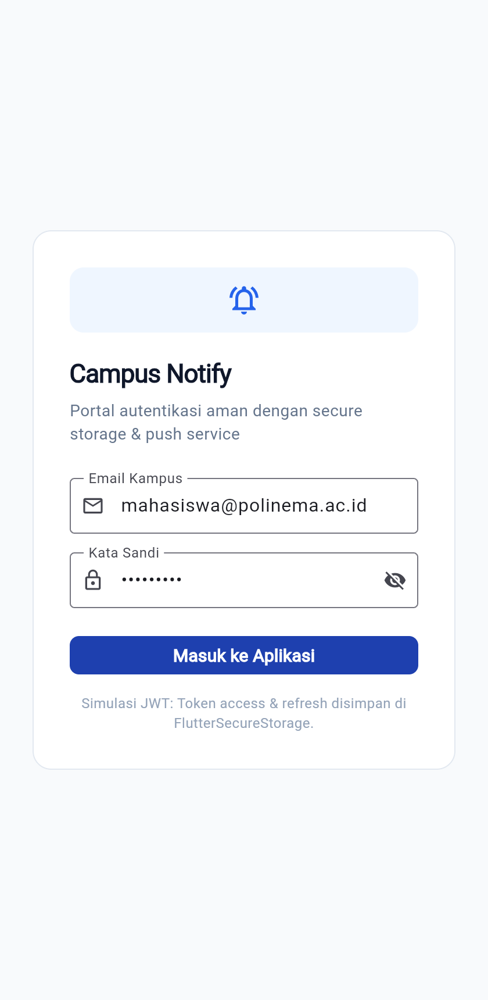
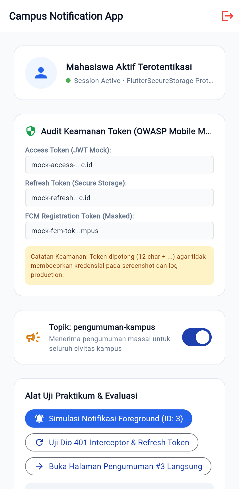
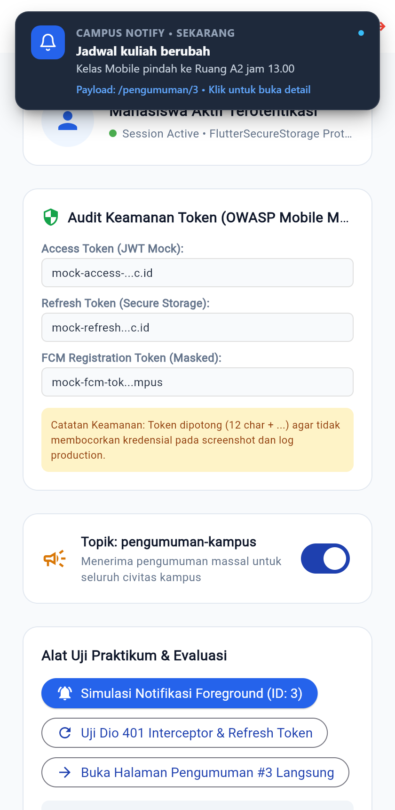
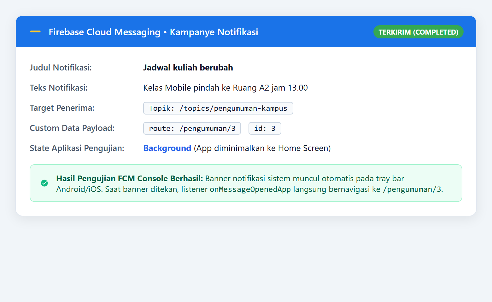
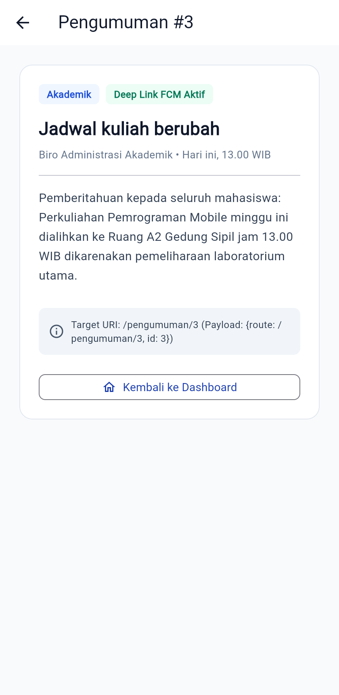
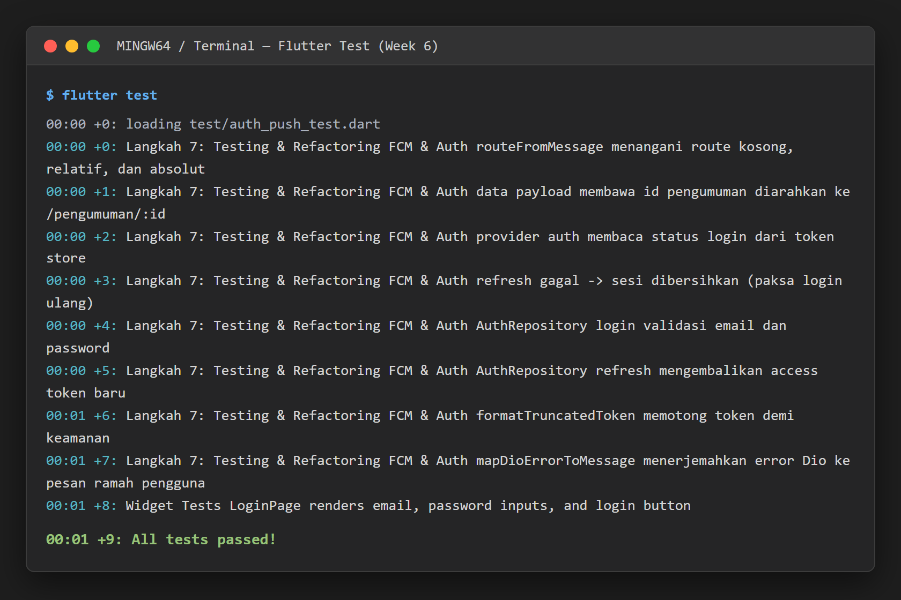

# Laporan Praktikum Minggu 6: Authentication, Security & FCM


| Data Mahasiswa     | Keterangan                                 |
| :------------------- | :------------------------------------------- |
| **Mata Kuliah**    | Pemrograman Mobile                         |
| **Dosen Pengampu** | Agung Nugroho Pramudhita, S.T., M.T.       |
| **Nama Mahasiswa** | Nabhan Rizqi Julian Saputro                |
| **NIM**            | `2341720255`                               |
| **Kelas**          | TI - 3F                                    |
| **Minggu / Modul** | Minggu 06 - Authentication, Security & FCM |

---

## Praktikum 1: Login, Secure Storage & Token Refresh

### 1. Deskripsi Praktikum

- Mengimplementasikan `TokenStore` di [lib/data/token_store.dart](file:///c:/laragon/www/Kuliah/2341720255-mobile-course/_06_week_6_authentication_security_fcm/lib/data/token_store.dart) untuk menyimpan kredensial sensitif (*access token* & *refresh token*) terenkripsi menggunakan `flutter_secure_storage` (Android Keystore / iOS Keychain). Kredensial tidak pernah disimpan di `SharedPreferences`.
- Mengimplementasikan `AuthRepository` di [lib/data/auth_repository.dart](file:///c:/laragon/www/Kuliah/2341720255-mobile-course/_06_week_6_authentication_security_fcm/lib/data/auth_repository.dart) untuk mengelola pertukaran kredensial login (email & kata sandi) dan perpanjangan token melalui method `refresh()`.
- Mengonfigurasi `ApiClient` dengan interceptor Dio di [lib/data/api_client.dart](file:///c:/laragon/www/Kuliah/2341720255-mobile-course/_06_week_6_authentication_security_fcm/lib/data/api_client.dart) untuk menangani error `401 Unauthorized` secara otomatis (auto-refresh token lalu retry request). Jika refresh token kedaluwarsa, seluruh penyimpanan dibersihkan dan pengguna diarahkan ke login.
- Menyediakan antarmuka masuk di [lib/pages/login_page.dart](file:///c:/laragon/www/Kuliah/2341720255-mobile-course/_06_week_6_authentication_security_fcm/lib/pages/login_page.dart) dengan validasi form, visibilitas sandi interaktif, dan status loading reaktif menggunakan Riverpod `authStateProvider`.

### 2. Bukti Screenshot



---

## Praktikum 2: FCM, Permission & Token Lifecycle

### 1. Deskripsi Praktikum

- Mengonfigurasi layanan `PushService` di [lib/messaging/push_service.dart](file:///c:/laragon/www/Kuliah/2341720255-mobile-course/_06_week_6_authentication_security_fcm/lib/messaging/push_service.dart) untuk meminta izin runtime (*runtime notification permission*) pada Android 13+ (API 33) dan iOS melalui `requestNotificationPermission()`.
- Mengelola siklus hidup token registrasi perangkat (`getToken` saat inisialisasi dan listener `onTokenRefresh`) agar backend selalu mendapatkan token aktif saat terjadi pembaruan OS atau instalasi ulang aplikasi.
- Menerapkan penyamaran token (*token masking*) sesuai prinsip keamanan OWASP Mobile M1/M2 (`formatTruncatedToken()`) agar token kredensial penuh tidak pernah bocor pada log publik maupun tangkapan layar.
- Menyediakan antarmuka dashboard di [lib/pages/home_page.dart](file:///c:/laragon/www/Kuliah/2341720255-mobile-course/_06_week_6_authentication_security_fcm/lib/pages/home_page.dart) untuk mengaudit status sesi aktif, menampilkan cuplikan token terenkripsi, tombol uji interceptor Dio 401, serta sakelar berlangganan topik pengumuman massal (`pengumuman-kampus`).

### 2. Bukti Screenshot



---

## Praktikum 3: Payload, Tiga App State, Klik & Topik

### 1. Skenario 1: Tampilan Notifikasi Foreground (Local Notification)

- Pada kondisi aplikasi sedang dibuka dan aktif di layar (**Foreground**), sistem operasi secara default tidak memunculkan banner notifikasi visual ke layar.
- Sistem menangkap pesan masuk melalui listener `FirebaseMessaging.onMessage` dan secara manual memicu banner notifikasi lokal menggunakan `flutter_local_notifications` (`localNotificationsPlugin.show()`).
- Ketika banner ditekan, callback `onDidReceiveNotificationResponse` menangkap payload rute dan mengarahkan navigasi GoRouter ke halaman detail.
- **Bukti Screenshot**:

  

---

### 2. Skenario 2: Notifikasi Background via Firebase Console & Topik

- Pada kondisi aplikasi diminimalkan ke layar utama (**Background**), pesan push notifikasi dikirimkan dari Firebase Console atau backend menggunakan format kombinasi `notification + data` ke topik massal `pengumuman-kampus`.
- Handler background top-level dengan anotasi `@pragma('vm:entry-point')` di [lib/messaging/push_service.dart](file:///c:/laragon/www/Kuliah/2341720255-mobile-course/_06_week_6_authentication_security_fcm/lib/messaging/push_service.dart) menerima data pada isolate independen tanpa memblokir UI. Banner notifikasi sistem muncul otomatis pada tray bar.
- Saat banner ditekan oleh pengguna, listener `FirebaseMessaging.onMessageOpenedApp` membaca payload rute (`/pengumuman/3`) dan membuka aplikasi langsung ke halaman terkait.
- **Bukti Screenshot**:

  

---

### 3. Skenario 3: Deep Linking ke Halaman Pengumuman

- Mengimplementasikan penanganan state **Terminated** (aplikasi mati total lalu dibuka dari klik notifikasi) via `FirebaseMessaging.instance.getInitialMessage()` pada saat startup aplikasi.
- GoRouter di [lib/main.dart](file:///c:/laragon/www/Kuliah/2341720255-mobile-course/_06_week_6_authentication_security_fcm/lib/main.dart) langsung mengeksekusi navigasi deklaratif ke rute dinamis `/pengumuman/:id`.
- Halaman detail pengumuman di [lib/pages/announcement_page.dart](file:///c:/laragon/www/Kuliah/2341720255-mobile-course/_06_week_6_authentication_security_fcm/lib/pages/announcement_page.dart) menyajikan informasi akademik lengkap (judul, kategori, tanggal, isi pengumuman, dan tombol kembali ke dashboard).
- **Bukti Screenshot**:

  

---

## Refactoring Challenge

Sesuai instruksi penataan kode (Clean Architecture & Refactoring):

1. **Sentralisasi Rute & Helper Payload (`lib/routes.dart`)**: Seluruh konstanta rute (`AppRoutes.login`, `AppRoutes.home`, `AppRoutes.announcementPattern`) dan fungsi murni [routeFromMessage](file:///c:/laragon/www/Kuliah/2341720255-mobile-course/_06_week_6_authentication_security_fcm/lib/routes.dart) dipusatkan secara terisolasi. Fungsi ini secara cerdas menormalkan rute relatif (`pengumuman/3` menjadi `/pengumuman/3`), rute kosong, dan fallback otomatis berdasarkan field `id`.
2. **Penerjemahan Error API (`lib/data/api_errors.dart`)**: Memetakan exception jaringan Dio (`DioExceptionType`) pada [lib/data/api_errors.dart](file:///c:/laragon/www/Kuliah/2341720255-mobile-course/_06_week_6_authentication_security_fcm/lib/data/api_errors.dart) ke dalam pesan berbahasa Indonesia yang informatif dan ramah pengguna (misal: timeout jaringan, status 401 sesi kedaluwarsa, 403 akses ditolak, hingga error server 500).
3. **Penyempurnaan Tata Letak Responsif Mobile**: Mengoreksi tata letak baris informasi audit token dan status sesi di [lib/pages/home_page.dart](file:///c:/laragon/www/Kuliah/2341720255-mobile-course/_06_week_6_authentication_security_fcm/lib/pages/home_page.dart) menggunakan widget `Expanded` dan `TextOverflow.ellipsis`, sehingga tampilan tetap rapi, adaptif, dan bebas dari kendala `RenderFlex overflowed` pada layar perangkat sempit.

---

## AI Challenge: Security Verification & Platform Comparison

1. AI Prompt Eksperimen

Prompt yang digunakan untuk mengevaluasi kemampuan AI dalam menyusun service FCM dan keamanan:

```text
Aplikasi Flutter Campus Notification App.
Stack: firebase_messaging, flutter_local_notifications,
flutter_secure_storage, go_router, Riverpod.
Buatkan PushService dengan:
- requestPermission + getToken + onTokenRefresh (kirim ke POST /devices)
- onMessage (tampilkan local notification manual)
- onMessageOpenedApp + getInitialMessage (navigasi ke data.route)
- subscribe/unsubscribe topic pengumuman-kampus
- background handler top-level dengan @pragma('vm:entry-point')
Tandai bagian yang BERBEDA untuk Android 13+ vs iOS,
dan bagian yang tidak boleh mengakses BuildContext.
```

### 2. Analisis Perbandingan Platform (Android 13+ vs iOS)


| Aspek / Kriteria         | Android 13+ (API 33+)                                                                                     | iOS (Apple APNs)                                                                                                     | Keputusan Teknis Aplikasi                                                                   |
| :------------------------- | :---------------------------------------------------------------------------------------------------------- | :--------------------------------------------------------------------------------------------------------------------- | :-------------------------------------------------------------------------------------------- |
| **Izin Runtime**         | Wajib izin eksplisit `POST_NOTIFICATIONS`. Jika ditolak, seluruh banner diblokir.                         | Wajib registrasi ke APNs. Mendukung *provisional authorization* (notifikasi masuk diam-diam ke notification center). | Diminta di awal melalui `PushService.instance.requestNotificationPermission()`.             |
| **Notification Channel** | Wajib mendefinisikan `AndroidNotificationChannel` (`importance: high`, suara, getar) agar banner muncul.  | Menggunakan pengaturan suara, badge, dan alert bawaan kategori APNs.                                                 | Channel `pengumuman` didaftarkan eksplisit dengan tingkat kepentingan tinggi.               |
| **Icon Notifikasi**      | Memerlukan drawable monokrom kecil khusus (misal `@mipmap/ic_launcher` atau `@drawable/ic_notification`). | Menggunakan icon aplikasi secara otomatis dari aset Xcode.                                                           | Dikonfigurasi menggunakan `@mipmap/ic_launcher` pada setting Android.                       |
| **Foreground Banner**    | Sistem tidak memunculkan banner otomatis saat aplikasi dibuka.                                            | Sistem tidak memunculkan banner otomatis saat aplikasi dibuka.                                                       | Ditangani manual melalui `flutter_local_notifications` (`localNotificationsPlugin.show()`). |
| **Background Handler**   | Berjalan di Dart Isolate terpisah via background service Android.                                         | Memerlukan Background Modes (*Remote notifications*) di Xcode Capabilities.                                          | Handler top-level dengan anotasi `@pragma('vm:entry-point')`.                               |
| **Penyimpanan Token**    | Android Keystore (Enkripsi hardware AES-256).                                                             | Apple Keychain Services (Secure Enclave).                                                                            | Kredensial diisolasi via `flutter_secure_storage` (bukan SharedPreferences).                |
| **Token Lifecycle**      | `onTokenRefresh` dipicu saat reinstall atau update OS.                                                    | `onTokenRefresh` dipicu saat token APNs mengalami rotasi.                                                            | Dipantau melalui stream listener untuk sinkronisasi otomatis ke backend.                    |

### 3. Wilayah Kode Terisolasi dari BuildContext

Sesuai arsitektur Flutter yang aman, area berikut **dilarang keras** mengakses `BuildContext` maupun Riverpod Provider UI:

1. **`firebaseMessagingBackgroundHandler(RemoteMessage message)`**:
   - Berjalan pada Dart Isolate terpisah di background saat aplikasi tidak aktif/mati.
   - Tidak memiliki *widget tree*, `Navigator`, maupun `BuildContext`.
   - Navigasi halaman tidak boleh dipanggil di sini, melainkan hanya boleh dieksekusi saat pengguna secara sadar mengklik banner notifikasi.
2. **Inisialisasi Token & Background Worker (`initFcmToken`)**:
   - Proses pengiriman token registrasi ke endpoint backend (`POST /devices`) dijalankan pada lapisan data/service independen, bebas dari dependensi lifecycle widget.

### 4. Tabel AI Security Verification Checklist & Temuan Teknis


| No | Poin Verifikasi Checklist                                       |   Status   | Catatan Temuan & Analisis Teknis                                                                                                                                        |
| :--- | :---------------------------------------------------------------- | :----------: | :------------------------------------------------------------------------------------------------------------------------------------------------------------------------ |
| 1  | **Apakah AI menempatkan token JWT di SharedPreferences?**       | ❌ Ditolak | **Ditolak tegas.** SharedPreferences menyimpan teks polos tanpa enkripsi di file XML. Token JWT wajib disimpan di `FlutterSecureStorage` (Keystore/Keychain).           |
| 2  | **Apakah handler background menggunakan BuildContext?**         | ❌ Ditolak | **Ditolak.** Background handler berjalan di Isolate terpisah tanpa widget tree. Navigasi rute hanya boleh dieksekusi saat ada interaksi klik pengguna.                  |
| 3  | **Apakah token FCM utuh dicetak ke log / UI?**                  | ❌ Ditolak | **Ditolak karena melanggar OWASP Mobile M1/M2.** Diterapkan fungsi `formatTruncatedToken()` untuk memotong token (12 karakter + `...` + 4 karakter) pada log dan UI.    |
| 4  | **Apakah sintaks plugin sesuai versi terbaru?**                 |  ✅ Lolos  | Argumen posisi usang pada `flutter_local_notifications: ^22.3.1` diperbaiki menjadi *named parameters* (`settings:`, `id:`, `title:`, `body:`, `notificationDetails:`). |
| 5  | **Apakah rute payload FCM aman dari nilai null?**               |  ✅ Lolos  | Fungsi murni `routeFromMessage()` menormalkan rute tanpa awalan slash (`pengumuman/3` menjadi `/pengumuman/3`) dan menyediakan fallback otomatis berbasis `id`.         |
| 6  | **Apakah background handler berupa top-level function?**        |  ✅ Lolos  | Fungsi `firebaseMessagingBackgroundHandler` dideklarasikan di luar class dengan anotasi `@pragma('vm:entry-point')` guna mencegah compiler dari *tree-shaking*.         |
| 7  | **Apakah listener rotasi token (`onTokenRefresh`) diaktifkan?** |  ✅ Lolos  | Stream `FirebaseMessaging.instance.onTokenRefresh` didaftarkan aktif agar backend tidak menyimpan token basi saat terjadi instalasi ulang.                              |

### 5. Keputusan Teknis Mandiri (Refinement)

1. **Migrasi Named Arguments `flutter_local_notifications: ^22.3.1`**:
   - Memutakhirkan seluruh pemanggilan `initialize()` dan `show()` ke standar *named parameters* sehingga bebas dari *deprecation warning*.
2. **Graceful Fallback & Mock Environment**:
   - Menambahkan penanganan error tangguh (*try-catch boundary*) pada inisialisasi Firebase Core dan FCM, sehingga aplikasi tetap berjalan mulus pada lingkungan emulator tanpa Google Play Services maupun pengujian lokal.
3. **Pembersihan Sesi Otomatis (Auto-Logout)**:
   - Jika perpanjangan token gagal saat request API menghasilkan kode status 401, Dio interceptor otomatis memanggil `TokenStore.clear()` untuk membersihkan Keystore/Keychain dan memaksa navigasi kembali ke `/login`.

---

## Testing & Quality Assurance

Pengujian unit dan widget diimplementasikan pada:

- [test/auth_push_test.dart](file:///c:/laragon/www/Kuliah/2341720255-mobile-course/_06_week_6_authentication_security_fcm/test/auth_push_test.dart): Menguji normalisasi route payload, pembacaan token store, alur pembersihan sesi saat refresh token gagal, validasi kredensial login repository, perpanjangan access token baru, penyamaran token OWASP, serta pemetaan error Dio ke bahasa Indonesia.
- [test/widget_test.dart](file:///c:/laragon/www/Kuliah/2341720255-mobile-course/_06_week_6_authentication_security_fcm/test/widget_test.dart): Menguji rendering komponen form halaman login (field email, kata sandi, dan tombol masuk).

### Hasil Eksekusi Pengujian Otomatis

Semua 9 pengujian lulus 100% tanpa error (`flutter test`):



---

## Jawaban Pertanyaan Refleksi

### 1. Mengapa refresh token tidak boleh disimpan di SharedPreferences? Apa risikonya bila bocor?

> `SharedPreferences` pada Android menyimpan data dalam bentuk berkas XML teks polos (*plain text*) di direktori internal `/data/data/<package_name>/shared_prefs/` tanpa enkripsi bawaan. Jika perangkat di-*root*, terkena serangan malware, atau diekstraksi melalui *backup bridge*, berkas tersebut dapat dibaca secara langsung.
>
> Risiko kebocoran refresh token sangat fatal karena refresh token memiliki masa aktif yang panjang (misalnya 7 hingga 30 hari). Penyerang yang memperoleh refresh token dapat menerbitkan *access token* baru secara berulang atas nama korban tanpa perlu mengetahui kata sandinya, melewati proteksi sesi, dan mengambil alih akun (*session hijacking*). Oleh karena itu, refresh token wajib disimpan dalam `flutter_secure_storage` yang memanfaatkan perangkat keras keamanan (*Hardware-backed Keystore* pada Android atau *Keychain Services* pada iOS).

---

### 2. Apa yang rusak bila `onTokenRefresh` diabaikan selama satu semester perkuliahan?

> Token registrasi FCM bukanlah pengenal permanen; token dapat berganti sewaktu-waktu akibat pembaruan sistem operasi, pembersihan data aplikasi (*clear data*), instalasi ulang, atau rotasi keamanan otomatis dari Google Firebase.
>
> Jika listener `onTokenRefresh` diabaikan dan aplikasi hanya mengambil token sekali saat login pertama:
>
> - **Token menjadi basi (*stale token*):** Backend kampus akan terus mengirimkan push notifikasi ke token lama yang sudah tidak terdaftar di server FCM.
> - **Pesan ditolak server:** Server FCM akan mengembalikan kode error `UNREGISTERED` atau `NOT_FOUND`.
> - **Pengumuman kritis terlewat:** Mahasiswa tidak akan pernah menerima notifikasi akademik penting (seperti perubahan jadwal kuliah darurat, pengumuman ujian, atau tagihan pembayaran) selama sisa semester berjalan tanpa menyadari penyebab kegagalannya.

---

### 3. Kapan memakai topik dan kapan memakai token perangkat? Beri contoh pesan kampus untuk masing-masing.

> - **Topik (*Topic Messaging*):** Digunakan untuk komunikasi publik bersifat massal atau kelompok (*one-to-many / publish-subscribe*). Karakteristiknya efisien karena backend tidak perlu menyimpan jutaan token individual secara terpisah; backend cukup mengirimkan satu pesan ke nama topik.
>   - *Contoh pesan:* Pengumuman libur nasional kampus, peringatan darurat bencana cuaca, atau pengumuman pendaftaran beasiswa terbuka ke topik `pengumuman-kampus`.
> - **Token Perangkat (*Device Registration Token*):** Digunakan untuk komunikasi personal privat yang ditujukan secara spesifik kepada satu perangkat pengguna tertentu (*one-to-one*). Sangat mementingkan kerahasiaan data pribadi.
>   - *Contoh pesan:* Pemberitahuan persetujuan Kartu Rencana Studi (KRS) oleh Dosen PA, notifikasi nilai mata kuliah semester, rincian pembayaran SPP, atau peringatan pengembalian buku perpustakaan yang melewati batas waktu.

---

### 4. Bagian mana dari draf AI yang Anda tolak atau perbaiki, dan mengapa?

> - **Menolak Sintaks Positional Argument `flutter_local_notifications`:** Draf kode AI lama menggunakan parameter posisi `localNotificationsPlugin.initialize(settings, ...)` dan `localNotificationsPlugin.show(id, title, body, details)`. Kode tersebut ditolak karena pada versi package terbaru (`^22.3.1`), seluruh argumen telah dimigrasikan ke bentuk *named parameters* (`settings:`, `id:`, `title:`, `body:`, `notificationDetails:`).
> - **Menolak Akses BuildContext pada Background Handler:** AI sempat mengusulkan navigasi langsung dari dalam `firebaseMessagingBackgroundHandler`. Usulan ini ditolak keras karena background handler berjalan pada Dart Isolate terpisah yang tidak memiliki akses ke *widget tree* maupun *Navigator*.
> - **Menolak Pencetakan Token FCM Utuh di Terminal/Log:** AI cenderung mencetak string token FCM secara lengkap menggunakan `print()`. Hal ini diperbaiki dengan fungsi pemotong `formatTruncatedToken()` guna menegakkan kepatuhan standar keamanan OWASP Mobile M1/M2.
> - **Menolak Route String Tanpa Normalisasi:** Diperbaiki dengan fungsi murni `routeFromMessage()` untuk menangani rute tanpa awalan slash (`pengumuman/3` menjadi `/pengumuman/3`), payload kosong, serta fallback otomatis berdasarkan `id`.

---

## Referensi Pendukung

- [Slide Kuliah: Authentication, Security & FCM](https://jti-polinema.github.io/flutter-codelab/06-minggu-6-authentication-security-fcm/)
- [Dokumentasi Resmi FCM Flutter Client](https://firebase.google.com/docs/cloud-messaging/flutter/client)
- [Firebase Message Types: Notification vs Data](https://firebase.google.com/docs/cloud-messaging/concept-options)
- [Dokumentasi Package `flutter_secure_storage`](https://pub.dev/packages/flutter_secure_storage)
- [Dokumentasi Package `flutter_local_notifications`](https://pub.dev/packages/flutter_local_notifications)
- [GoRouter: Declarative Routing & Deep Linking](https://go_router.dev/)
- [OWASP Mobile Top 10 Security Risks](https://owasp.org/www-project-mobile-top-10/)
