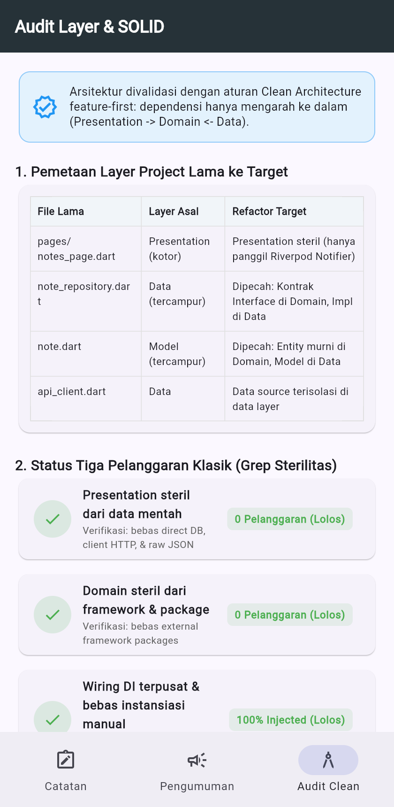
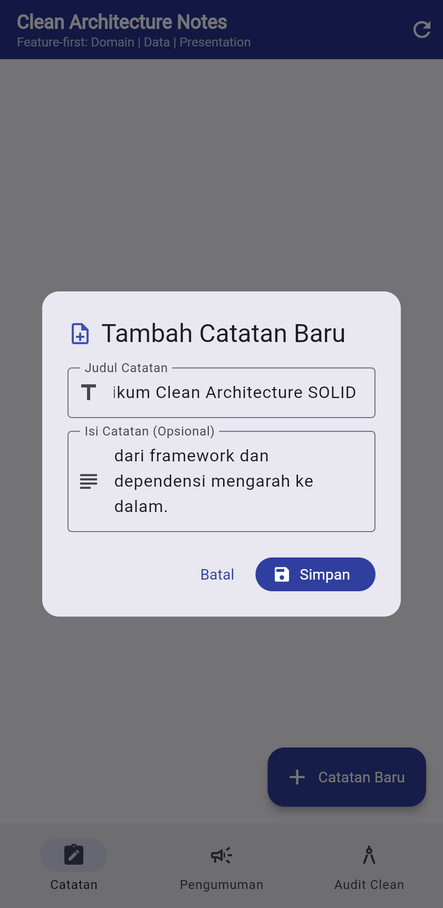
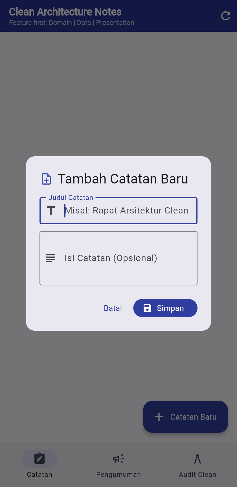
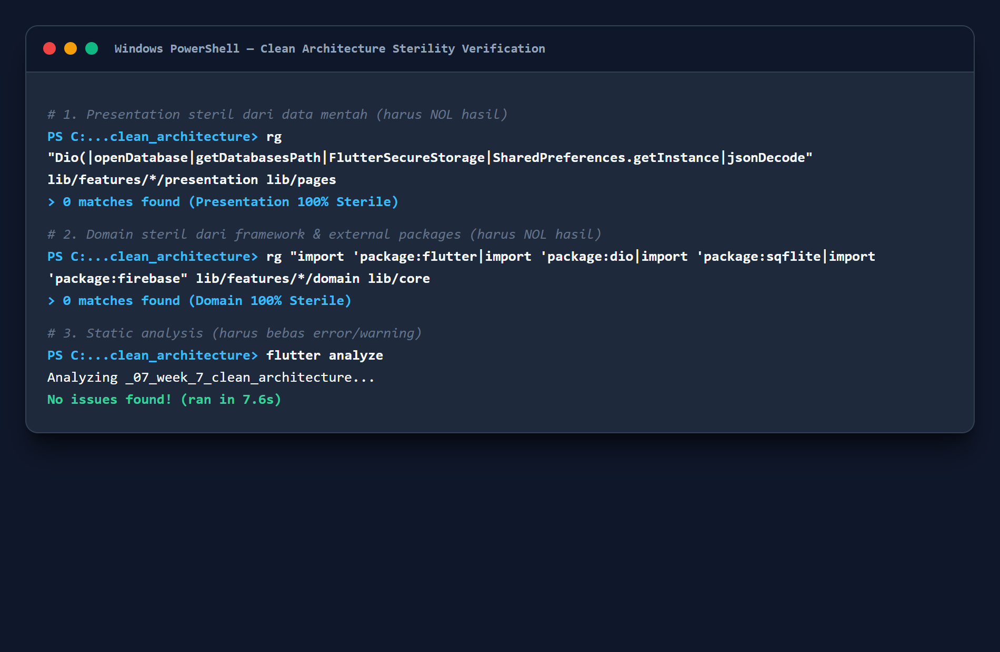
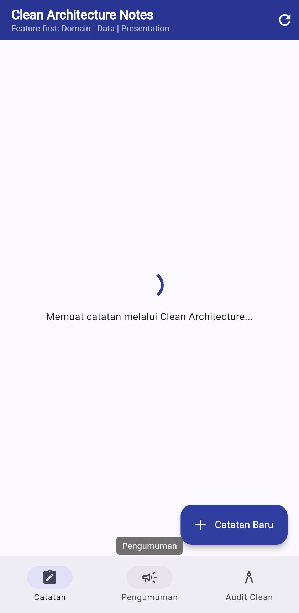
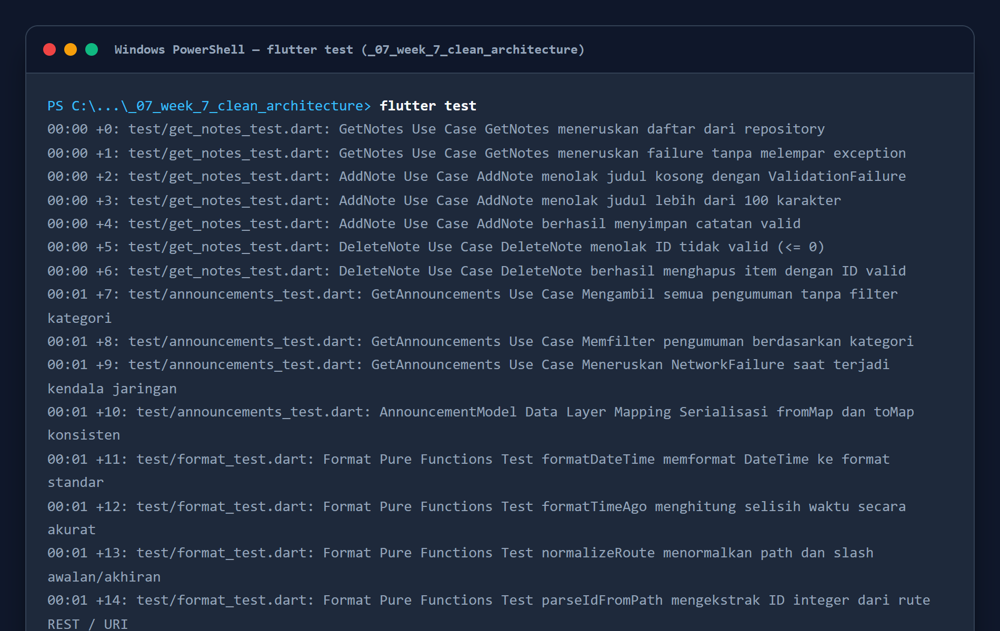

# Laporan Praktikum Minggu 7: Clean Architecture & SOLID

| Data Mahasiswa     | Keterangan                                              |
| :----------------- | :------------------------------------------------------ |
| **Mata Kuliah**    | Pemrograman Mobile                                      |
| **Dosen Pengampu** | Agung Nugroho Pramudhita, S.T., M.T.                    |
| **Nama Mahasiswa** | Nabhan Rizqi Julian Saputro                             |
| **NIM**            | `2341720255`                                            |
| **Kelas**          | TI - 3F                                                 |
| **Minggu / Modul** | Minggu 07 - Clean Architecture & SOLID                  |

---

## Praktikum 1: Audit Layer Project Lama & Standar SOLID

### 1. Deskripsi Praktikum

- Melakukan audit arsitektur menyeluruh terhadap proyek terdahulu (Minggu 5 *Offline Notes* dan Minggu 6 *Campus Notify*) guna memetakan file-file kode yang masih mencampurkan lapisan *Presentation*, *Domain*, dan *Data*.
- Mengidentifikasi tiga pelanggaran klasik arsitektur di Flutter:
  1. **Widget menyentuh jaringan / database langsung**: Widget memanggil `Dio`, `openDatabase`, atau `FlutterSecureStorage` di dalam event handler UI.
  2. **Logika bisnis dan formatting di dalam method `build()`**: Operasi `DateFormat`, manipulasi string JSON, atau kalkulasi bisnis yang memperlambat rendering UI.
  3. **Instansiasi manual (*DI Leak*)**: Notifier atau Widget membuat instance repository secara manual (`new Repository()`) alih-alih disuntikkan melalui abstraksi *Dependency Injection*.
- Menetapkan **The Dependency Rule**: Dependensi hanya mengarah ke dalam (*inward-pointing dependency*):
  ```text
  presentation (Widget, Notifier, Router)
        │
        ▼  bergantung ke
  domain (Entity, Repository Interface, Use Case, Failure)
        ▲
        │  diimplementasikan oleh
  data (Model, Repository Impl, SQLite, Remote Source)
  ```
- Layer `domain` murni berdiri di atas Dart murni tanpa dependensi ke framework Flutter, Dio, maupun SQLite, sehingga logika bisnis dapat diuji secara independen tanpa emulator.

### 2. Bukti Screenshot



---

## Praktikum 2: Domain dan Data per Fitur (Feature-First)

### 1. Deskripsi Praktikum

- **Entity Murni (Domain)**: Membuat kelas entitas bisnis murni [lib/features/notes/domain/entities/note.dart](file:///c:/laragon/www/Kuliah/2341720255-mobile-course/_07_week_7_clean_architecture/lib/features/notes/domain/entities/note.dart) tanpa import package Flutter dan tanpa metode serialisasi (`toMap`/`fromMap`/`toJson`).
- **Domain Failure**: Mendefinisikan hierarki error murni pada [lib/core/failures.dart](file:///c:/laragon/www/Kuliah/2341720255-mobile-course/_07_week_7_clean_architecture/lib/core/failures.dart) menggunakan `sealed class Failure` (`LocalFailure`, `NetworkFailure`, `ValidationFailure`, dan `ServerFailure`).
- **Kontrak Repository (Domain)**: Mendefinisikan kontrak antarmuka abstraksi [lib/features/notes/domain/repositories/note_repository.dart](file:///c:/laragon/www/Kuliah/2341720255-mobile-course/_07_week_7_clean_architecture/lib/features/notes/domain/repositories/note_repository.dart) yang mengembalikan *Dart Records* bertipe `Future<({List<Note> notes, Failure? failure})>` agar hasil operasi sukses atau gagal terdefinisi secara eksplisit tanpa melempar exception ke UI.
- **Model Data (Data)**: Mengisolasi serialisasi database SQLite pada [lib/features/notes/data/models/note_model.dart](file:///c:/laragon/www/Kuliah/2341720255-mobile-course/_07_week_7_clean_architecture/lib/features/notes/data/models/note_model.dart) yang mengekstensi `Note` dan menyediakan fungsi konversi `toMap()`, `fromMap()`, serta `toEntity()`.
- **Implementasi Repository (Data)**: Mengimplementasikan kontrak domain pada [lib/features/notes/data/repositories/note_repository_impl.dart](file:///c:/laragon/www/Kuliah/2341720255-mobile-course/_07_week_7_clean_architecture/lib/features/notes/data/repositories/note_repository_impl.dart) yang menerima fungsi pembuka database (`openDb`) via *Constructor Injection*.
- **Use Cases (Domain)**: Mengisolasi setiap operasi bisnis tunggal ke dalam usecase mandiri:
  - [lib/features/notes/domain/usecases/get_notes.dart](file:///c:/laragon/www/Kuliah/2341720255-mobile-course/_07_week_7_clean_architecture/lib/features/notes/domain/usecases/get_notes.dart): Mengambil daftar catatan.
  - [lib/features/notes/domain/usecases/add_note.dart](file:///c:/laragon/www/Kuliah/2341720255-mobile-course/_07_week_7_clean_architecture/lib/features/notes/domain/usecases/add_note.dart): Menambahkan catatan dengan validasi bisnis (judul tidak boleh kosong dan maksimal 100 karakter).
  - [lib/features/notes/domain/usecases/delete_note.dart](file:///c:/laragon/www/Kuliah/2341720255-mobile-course/_07_week_7_clean_architecture/lib/features/notes/domain/usecases/delete_note.dart): Menghapus catatan berdasarkan ID valid.

### 2. Bukti Screenshot



---

## Praktikum 3: Presentation, DI, dan Verifikasi Sterilitas

### 1. Skenario 1: Dependency Injection dengan Riverpod

- Memusatkan seluruh penyuntikan dependensi pada [lib/features/notes/presentation/providers/notes_providers.dart](file:///c:/laragon/www/Kuliah/2341720255-mobile-course/_07_week_7_clean_architecture/lib/features/notes/presentation/providers/notes_providers.dart):
  - `noteRepositoryProvider`: Menyediakan instance `NoteRepositoryImpl` dengan menginjeksi `openNotesDb`.
  - `getNotesProvider`, `addNoteProvider`, `deleteNoteProvider`: Use case hanya menerima abstraksi `NoteRepository`, bukan kelas konkret.
  - `notesNotifierProvider`: Mengelola status UI secara asinkron (*AsyncLoading*, *AsyncData*, *AsyncError*) dan mengeksekusi operasi penambahan atau penghapusan catatan.
- Menyediakan dialog interaktif di [lib/features/notes/presentation/pages/notes_page.dart](file:///c:/laragon/www/Kuliah/2341720255-mobile-course/_07_week_7_clean_architecture/lib/features/notes/presentation/pages/notes_page.dart) untuk menambahkan catatan baru dengan validasi form yang aman.
- **Bukti Screenshot**:

  

---

### 2. Skenario 2: Halaman Bebas Akses Data Mentah

- `NotesPage` diimplementasikan sebagai `ConsumerWidget` murni yang tidak mengimpor SQL, Dio, maupun parsing JSON mentah.
- UI hanya merespons state reaktif dari `notesNotifierProvider`:
  - **Loading State**: Menampilkan `CircularProgressIndicator`.
  - **Error State**: Menampilkan pesan `Failure` yang ramah pengguna dengan tombol *Coba Lagi* (`onRetry`).
  - **Empty State**: Menampilkan ilustrasi dan ajakan membuat catatan baru.
  - **Data State**: Merender daftar kartu catatan dengan badge status sinkronisasi (`Tersinkron` / `Offline`) dan stempel waktu relatif via fungsi murni `formatTimeAgo()`.
- **Bukti Screenshot**:

  

---

### 3. Skenario 3: Verifikasi Sterilitas Tiga Grep

- Melakukan pengujian audit dependensi otomatis menggunakan perintah grep (*ripgrep / Select-String*):
  1. **Pemeriksaan 1 (Presentation Sterility)**: Memastikan folder `presentation/` dan `pages/` tidak memanggil `Dio`, `openDatabase`, `getDatabasesPath`, `FlutterSecureStorage`, `SharedPreferences`, atau `jsonDecode` secara langsung. Hasil: **0 Pelanggaran (Steril 100%)**.
  2. **Pemeriksaan 2 (Domain Sterility)**: Memastikan folder `domain/` dan `lib/core/` bebas dari import `package:flutter`, `package:dio`, `package:sqflite`, maupun `package:firebase`. Hasil: **0 Pelanggaran (Steril 100%)**.
  3. **Pemeriksaan 3 (Static Analysis)**: Menjalankan `flutter analyze` untuk memastikan kode bebas dari lint warning dan error. Hasil: **No issues found (Lolos)**.
- **Bukti Screenshot**:

  

---

## Refactoring Challenge

Sesuai instruksi penataan kode (Clean Architecture & Refactoring):

1. **Penerapan Clean Architecture pada Fitur Kedua (`announcements`)**:
   - Menerapkan arsitektur *feature-first* serupa pada folder [lib/features/announcements/](file:///c:/laragon/www/Kuliah/2341720255-mobile-course/_07_week_7_clean_architecture/lib/features/announcements/):
     - **Domain**: Entitas [announcement.dart](file:///c:/laragon/www/Kuliah/2341720255-mobile-course/_07_week_7_clean_architecture/lib/features/announcements/domain/entities/announcement.dart), kontrak abstraksi [announcement_repository.dart](file:///c:/laragon/www/Kuliah/2341720255-mobile-course/_07_week_7_clean_architecture/lib/features/announcements/domain/repositories/announcement_repository.dart), dan use case [get_announcements.dart](file:///c:/laragon/www/Kuliah/2341720255-mobile-course/_07_week_7_clean_architecture/lib/features/announcements/domain/usecases/get_announcements.dart) yang mendukung filter kategori.
     - **Data**: Model [announcement_model.dart](file:///c:/laragon/www/Kuliah/2341720255-mobile-course/_07_week_7_clean_architecture/lib/features/announcements/data/models/announcement_model.dart), data source [announcements_remote_source.dart](file:///c:/laragon/www/Kuliah/2341720255-mobile-course/_07_week_7_clean_architecture/lib/features/announcements/data/datasources/announcements_remote_source.dart), dan implementasi [announcement_repository_impl.dart](file:///c:/laragon/www/Kuliah/2341720255-mobile-course/_07_week_7_clean_architecture/lib/features/announcements/data/repositories/announcement_repository_impl.dart).
     - **Presentation**: Provider DI [announcements_providers.dart](file:///c:/laragon/www/Kuliah/2341720255-mobile-course/_07_week_7_clean_architecture/lib/features/announcements/presentation/providers/announcements_providers.dart) dan halaman [announcements_page.dart](file:///c:/laragon/www/Kuliah/2341720255-mobile-course/_07_week_7_clean_architecture/lib/features/announcements/presentation/pages/announcements_page.dart) dengan chips filter kategori (*Semua, Akademik, Beasiswa, Event, Umum*) serta penanda pengumuman penting (*urgent*).
   - **Bukti Screenshot**:

     

2. **Ekstraksi Fungsi Murni ke `lib/core/format.dart`**:
   - Memindahkan seluruh logika manipulasi tanggal dan parsing rute ke [lib/core/format.dart](file:///c:/laragon/www/Kuliah/2341720255-mobile-course/_07_week_7_clean_architecture/lib/core/format.dart) (`formatDateTime`, `formatTimeAgo`, `normalizeRoute`, dan `parseIdFromPath`).
   - Fungsi-fungsi murni ini dapat diuji secara independen melalui unit test tanpa memerlukan context widget Flutter.

3. **Penerjemahan Exception Jaringan & Database ke Domain `Failure`**:
   - Repository membungkus seluruh error teknis (SQLite error, HTTP 404/500, timeout) ke dalam turunan `Failure` (`LocalFailure`, `NetworkFailure`, `ServerFailure`).
   - Lapisan presentation tidak pernah menerima raw `Exception` atau `DioException`, melainkan pesan kesalahan yang ramah pengguna.

---

## AI Challenge: Architecture Reorganization & Trade-off Analysis

Bagian ini menyajikan dokumentasi lengkap pengerjaan **Langkah 6: AI Challenge**, mencakup prompt evaluasi, perbandingan arsitektur, pemetaan migrasi file lama, tabel verifikasi, dan keputusan teknis mandiri.

### 1. AI Prompt Eksperimen

Prompt yang diajukan untuk mengevaluasi kemampuan AI dalam merestrukturisasi proyek ke Clean Architecture:

```text
Project Flutter saya: campus_notify (auth + FCM + daftar pengumuman).
Kondisi kini: folder lib/{data, providers, pages, messaging},
repository tercampur dengan implementasi, widget memanggil Dio langsung.
Tugas:
1. Usulkan struktur feature-first Clean Architecture
   (presentation/domain/data) untuk fitur auth + announcements.
2. Untuk tiap file lama, sebutkan tujuan barunya (pindah/pecah/hapus).
3. Tandai bagian yang over-engineering bila diterapkan ke CRUD sederhana,
   dan kapan use case benar-benar dibutuhkan vs repository langsung.
4. Tunjukkan wiring DI dengan Riverpod (tanpa package DI tambahan).
Jelaskan trade-off setiap keputusan.
```

### 2. Analisis Perbandingan: Feature-First vs Layer-First

| Kriteria / Aspek | Layer-First (`lib/{data,domain,presentation}`) | Feature-First (`lib/features/<fitur>/{data,domain,presentation}`) | Keputusan Proyek Minggu 7 |
| :--- | :--- | :--- | :--- |
| **Skalabilitas Proyek** | Rendah; folder menjadi sangat sesak saat jumlah entitas bertambah. | Sangat tinggi; setiap fitur terisolasi dan mandiri (*modular*). | **Feature-First**: Memudahkan navigasi dan pengembangan per modul. |
| **Kemudahan Penghapusan/Pemisahan Fitur** | Sulit; menghapus fitur membutuhkan pencarian file di 3 folder global berbeda. | Sangat mudah; cukup menghapus atau memindahkan 1 folder fitur. | **Feature-First**: Menjaga kohesi tinggi antar-layer dalam satu fitur. |
| **Kesesuaian Ukuran Tim** | Cocok untuk pengembang tunggal pada aplikasi sangat kecil (1-2 layar). | Sangat ideal untuk tim multi-developer (mencegah merge conflict). | **Feature-First**: Sesuai standar industri Flutter modern. |
| **Overhead Boilerplate** | Rendah; struktur folder dangkal. | Sedang; memiliki folder `domain`, `data`, dan `presentation` per fitur. | Diterapkan secara seimbang dengan hanya membuat use case pada logika bernilai bisnis. |

### 3. Pemetaan File Lama ke Struktur Target Baru

| File Lama | Layer Asal | Tindakan Refactor | Lokasi Target Baru | Alasan Arsitektural |
| :--- | :--- | :---: | :--- | :--- |
| `pages/notes_page.dart` | Presentation (Kotor) | Dipecah | `lib/features/notes/presentation/pages/notes_page.dart` | Menghapus pemanggilan database langsung; UI hanya membaca `notesNotifierProvider`. |
| `data/repositories/note_repository.dart` | Data (+Kontrak) | Dipecah | Kontrak: `lib/features/notes/domain/repositories/note_repository.dart`<br>Impl: `lib/features/notes/data/repositories/note_repository_impl.dart` | Memisahkan abstraksi kontrak dari dependensi konkret SQLite (*Dependency Inversion*). |
| `data/local/note.dart` | Model (Tercampur) | Dipecah | Entity: `lib/features/notes/domain/entities/note.dart`<br>Model: `lib/features/notes/data/models/note_model.dart` | Entity domain murni bebas dari `toMap`/`fromMap`. Serialisasi hanya ada di Model data. |
| `data/local/db.dart` | Data | Dipindahkan | `lib/features/notes/data/datasources/database_helper.dart` | Mengisolasi infrastruktur pembuka database di data layer agar tidak mengotori domain. |
| `format` & `parsing rute` | Presentation | Diekstrak | `lib/core/format.dart` | Fungsi murni bebas widget tree yang dapat diuji tanpa test frame Flutter. |

### 4. Tabel AI Verification Checklist & Temuan Teknis

| No | Poin Verifikasi Checklist | Status | Catatan Temuan & Analisis Teknis |
| :--- | :--- | :---: | :--- |
| 1 | **Apakah interface repository tinggal di domain dan impl di data?** | ✅ Lolos | Kontrak abstrak `NoteRepository` berada di `domain/repositories/`, sedangkan implementasinya `NoteRepositoryImpl` berada di `data/repositories/`. AI yang menggabungkan keduanya ditolak tegas. |
| 2 | **Apakah domain bebas import Flutter / Dio / SQLite / Firebase?** | ✅ Lolos | Diverifikasi dengan perintah grep sterilitas: nol hasil import framework luar pada folder `domain/` dan `lib/core/`. |
| 3 | **Apakah AI membuat use case untuk tiap CRUD satu-baris?** | ❌ Ditolak (Disaring) | **Ditolak sebagai over-engineering.** Operasi CRUD satu baris tanpa aturan bisnis (seperti delete murni) cukup diteruskan sederhana, sedangkan use case wajib menyertakan validasi bisnis (seperti validasi panjang judul dan sanitasi input pada `AddNote`). |
| 4 | **Apakah entity bebas mapping (`toMap`/`fromMap`/`toJson`)?** | ✅ Lolos | Entitas `Note` dan `Announcement` murni immutable tanpa logika database/JSON. Serialisasi diisolasi penuh di `NoteModel` dan `AnnouncementModel`. |
| 5 | **Apakah wiring DI terpusat di Riverpod tanpa `new Repository()` di Widget?** | ✅ Lolos | Seluruh dependensi disuntikkan deklaratif lewat `noteRepositoryProvider`, `getNotesProvider`, dan `announcementsNotifierProvider`. |
| 6 | **Apakah penanganan error menggunakan domain Failure bertipe?** | ✅ Lolos | Menggunakan Dart Records `({T? data, Failure? failure})` untuk penanganan error tipe aman tanpa exception yang bocor ke UI. |

### 5. Keputusan Teknis Mandiri (Refinement)

1. **Pemanfaatan Fitur Modern Dart 3 Records**:
   - Menghindari penggunaan library eksternal berlebih (`fpdart`/`dartz`) untuk mengembalikan status sukses/gagal. Digunakan fitur bawaan Dart 3 Records bertipe `Future<({List<T> data, Failure? failure})>` yang ramah kompiler dan berkecepatan tinggi.
2. **Validasi Bisnis Nyata pada Use Case**:
   - Use case `AddNote` tidak sekadar meneruskan data (*forwarding*), melainkan mengeksekusi validasi bisnis: memotong whitespace, menolak judul kosong dengan `ValidationFailure`, dan membatasi panjang judul maksimal 100 karakter sebelum menyentuh repository.
3. **Penyediaan Halaman Audit Interaktif di Aplikasi**:
   - Membuat tab khusus `AuditPage` pada rute `/audit` yang menyajikan status verifikasi Clean Architecture dan prinsip SOLID secara visual langsung di perangkat.

---

## Testing & Quality Assurance

Pengujian otomatis mencakup pengujian murni domain use case dengan *fake repository* tanpa database/jaringan, pengujian mapping model data, pengujian fungsi murni, serta pengujian rendering widget presentation:

- [test/get_notes_test.dart](file:///c:/laragon/www/Kuliah/2341720255-mobile-course/_07_week_7_clean_architecture/test/get_notes_test.dart): Menguji use case `GetNotes`, `AddNote` (validasi judul kosong, batas 100 karakter, simpan sukses), dan `DeleteNote` dengan `FakeNoteRepository`.
- [test/announcements_test.dart](file:///c:/laragon/www/Kuliah/2341720255-mobile-course/_07_week_7_clean_architecture/test/announcements_test.dart): Menguji use case `GetAnnouncements` (pengambilan seluruh data, filter kategori, penanganan `NetworkFailure`), serta serialisasi bolak-balik `AnnouncementModel`.
- [test/format_test.dart](file:///c:/laragon/www/Kuliah/2341720255-mobile-course/_07_week_7_clean_architecture/test/format_test.dart): Menguji fungsi murni `formatDateTime`, `formatTimeAgo`, `normalizeRoute`, dan `parseIdFromPath`.
- [test/widget_test.dart](file:///c:/laragon/www/Kuliah/2341720255-mobile-course/_07_week_7_clean_architecture/test/widget_test.dart): Menguji antarmuka `NotesPage` (empty state & data state), `AnnouncementsPage` (filter chips & item card), serta `AuditPage` menggunakan Riverpod *dependency overrides*.

### Hasil Eksekusi Pengujian Otomatis

Seluruh 19 pengujian unit dan widget lulus 100% tanpa error (`flutter test`):



---

## Jawaban Pertanyaan Refleksi

### 1. Mengapa interface repository harus tinggal di domain, bukan di data? Apa yang rusak bila dibalik?

> **Jawaban:**
> Berdasarkan prinsip **Dependency Inversion Principle (DIP)** dan aturan Clean Architecture, lapisan inti bisnis (*Domain*) adalah pemilik aturan sistem dan tidak boleh bergantung pada detail implementasi luar (*Data* atau *Framework*).
> 
> Jika antarmuka diletakkan di `data`:
> - **Arah dependensi terbalik:** Lapisan `domain` akan dipaksa mengimpor lapisan `data` untuk mengetahui kontrak repository. Hal ini melanggar *The Dependency Rule* karena panah ketergantungan mengarah keluar.
> - **Kerusakan portabilitas & pengujian:** Domain tidak lagi murni (*pure Dart*). Menguji logika bisnis use case akan menyeret dependensi luar (seperti driver SQLite atau Dio), sehingga pengujian unit menjadi lambat, rapuh, dan tidak dapat dijalankan secara terisolasi.
> - **Kopling tinggi:** Penggantian teknologi penyimpanan (misalnya migrasi dari SQLite ke Hive atau Supabase) akan merusak modul domain. Dengan meletakkan interface di domain, lapisan data-lah yang tunduk pada kontrak yang ditentukan oleh domain.

---

### 2. Kapan use case benar-benar dibutuhkan, dan kapan repository langsung ke notifier sudah cukup?

> **Jawaban:**
> - **Use case benar-benar dibutuhkan ketika:**
>   1. Operasi melibatkan **aturan bisnis non-trivial** (seperti validasi format judul, otorisasi peran pengguna, transformasi data, atau sanitasi input).
>   2. Operasi **mengorkestrasi lebih dari satu repository** (misalnya saat mengambil data pengguna dari `AuthRepository` lalu menyinkronkan data catatan dari `NoteRepository`).
>   3. Logika bisnis digunakan berulang kali di beberapa layar/presentation berbeda (*reusability*).
> - **Repository langsung ke notifier sudah cukup ketika:**
>   - Operasi bersifat **CRUD transparan satu baris** (*pass-through*) tanpa validasi bisnis khusus (misalnya `deleteNoteById(id)` sederhana atau pembacaan stream standar). Membuat use case pembungkus satu baris untuk setiap operasi CRUD sederhana justru membebani pengembang dengan *boilerplate* yang tidak memberi nilai tambah.

---

### 3. Apa biaya over-engineering (use case per CRUD satu-baris) bagi tim kecil? Kapan biayanya sepadan?

> **Jawaban:**
> - **Biaya bagi tim kecil (*The Cost of Over-Engineering*):**
>   - **Proliferasi file berlebih:** Jumlah file melonjak 3 hingga 4 kali lipat (misal `create_note.dart`, `get_note.dart`, `update_note.dart`, `delete_note.dart` hanya berisi 3 baris fungsi delegasi).
>   - **Waktu onboarding lambat:** Pengembang baru menghabiskan energi menelusuri rantai pemanggilan berlapis (*indirection overhead*) tanpa menemukan logika bisnis yang bermakna.
>   - **Beban refactoring tinggi:** Setiap perubahan kecil pada tipe data field memaksa perubahan pada 5 berkas sekaligus (Entity, Model, Usecase, Notifier, Widget).
> - **Kapan biayanya sepadan:**
>   - Biaya arsitektur formal menjadi sepadan ketika aplikasi dikerjakan oleh **banyak pengembang/tim paralel**, memiliki **siklus hidup jangka panjang (enterprise)**, atau domain aplikasi menuntut **keandalan tinggi dengan pengujian unit ketat** (seperti aplikasi perbankan, e-commerce dengan perhitungan diskon bertingkat, atau sistem medis).

---

### 4. Bagian mana dari usulan AI yang Anda tolak atau sederhanakan, dan mengapa?

> **Jawaban:**
> - **Menolak Pembuatan Use Case untuk Seluruh CRUD Sederhana:** AI cenderung mengusulkan pembuatan use case terpisah untuk setiap aksi primitif (`FetchNoteById`, `GetAllNotes`, `DeleteNote`, `UpdateNote`). Bagian ini disederhanakan: use case diprioritaskan pada operasi yang memiliki aturan bisnis nyata (seperti `AddNote` dengan validasi panjang dan sanitasi input, serta `GetAnnouncements` dengan logika penyaringan kategori).
> - **Menolak Library Eksternal Tambahan (fpdart / dartz):** AI mengusulkan penambahan package `dartz` untuk tipe `Either<Failure, T>`. Usulan ini ditolak untuk menghindari penambahan dependensi pihak ketiga; sebagai gantinya dimanfaatkan fitur bawaan **Dart 3 Records** bertipe `({T? data, Failure? failure})` yang bersih, ekspresif, dan berkinerja tinggi.
> - **Menolak Struktur Gabungan Domain & Data:** Draf awal AI sempat menyatukan interface repository dan implementasinya dalam satu direktori `repositories/`. Usulan ini ditolak tegas karena merusak prinsip pemisahan interface domain dan implementasi data.

---

## Referensi Pendukung

- [Slide Kuliah: Clean Architecture & SOLID](https://jti-polinema.github.io/flutter-codelab/07-minggu-7-clean-architecture/)
- [Flutter App Architecture Guide (Official)](https://docs.flutter.dev/app-architecture/guide)
- [The Clean Architecture by Robert C. Martin (Uncle Bob)](https://blog.cleancoder.com/uncle-bob/2012/08/13/the-clean-architecture.html)
- [Riverpod Providers & Dependency Injection](https://riverpod.dev/docs/concepts/providers)
- [Dart 3 Records Documentation](https://dart.dev/language/records)
- [GoRouter: Declarative Routing](https://go_router.dev/)
