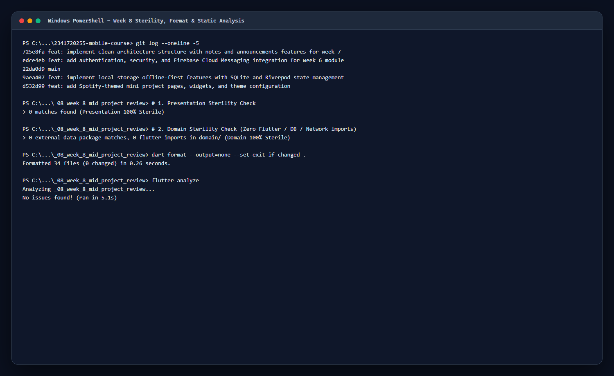
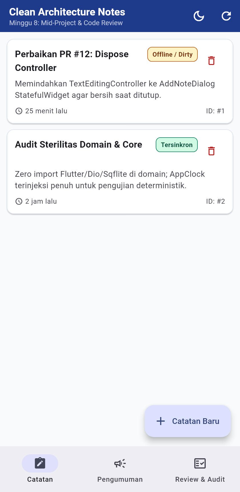
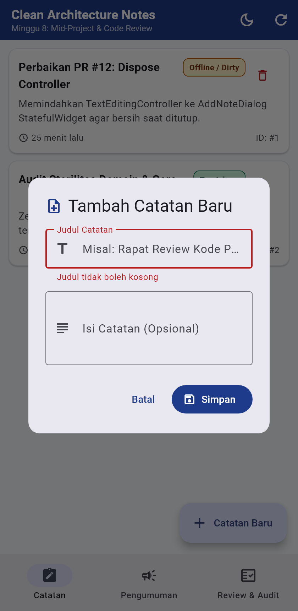
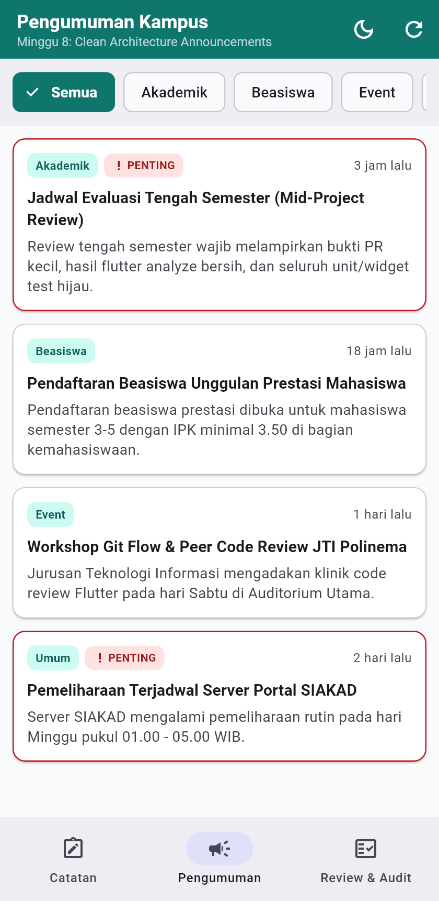
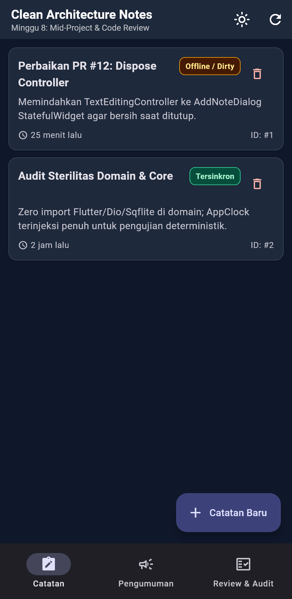
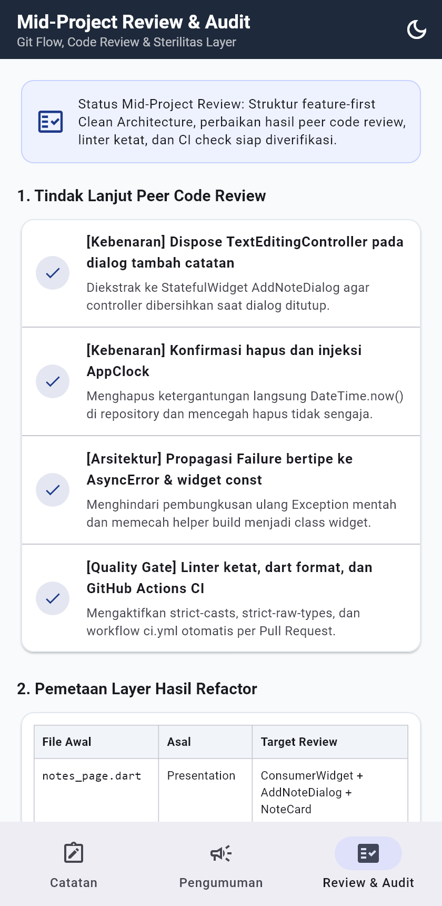
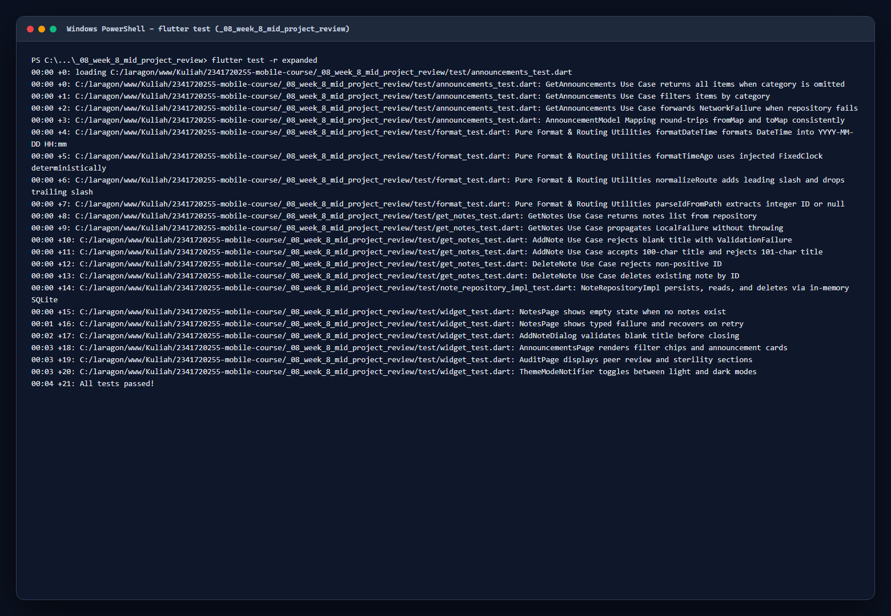

# Laporan Praktikum Minggu 8: Mid-Project Review & Code Review

| Data Mahasiswa     | Keterangan                                       |
| :----------------- | :----------------------------------------------- |
| **Mata Kuliah**    | Pemrograman Mobile                               |
| **Dosen Pengampu** | Agung Nugroho Pramudhita, S.T., M.T.             |
| **Nama Mahasiswa** | Nabhan Rizqi Julian Saputro                      |
| **NIM**            | `2341720255`                                     |
| **Kelas**          | TI - 3F                                          |
| **Minggu / Modul** | Minggu 08 - Mid-Project Review & Code Review     |

---

## Praktikum 1: Hygiene Branch, Audit Riwayat & Commit Konvensional

### 1. Deskripsi Praktikum

- Melakukan audit langsung terhadap riwayat Git repositori (`git log --oneline -15`, `git branch -a`, dan `git status`) untuk mengevaluasi kedisiplinan kolaborasi paruh semester pada proyek Minggu 5 sampai 7.
- **Temuan Audit Riwayat Nyata**:
  1. Seluruh commit terdahulu hanya berada pada satu branch tunggal (`* main` dan `remotes/origin/main`) tanpa branch integrasi `develop` maupun pemisahan `feature/*` dan `fix/*`.
  2. Ditemukan pesan commit non-konvensional (`22da0d9 main`) serta commit berskala besar yang menggabungkan implementasi UI, layer data, test, dan dokumentasi sekaligus dalam satu commit (`725e8fa` mencakup 35 file, 2.504 baris).
- Menetapkan standar **Git Flow** untuk paruh kedua semester:
  - `main`: Branch rilis yang dilindungi (tidak menerima commit langsung).
  - `develop`: Branch integrasi mingguan sebagai target default seluruh Pull Request.
  - `feature/*` & `fix/*`: Branch pendek (< 3 hari kerja, < 300 baris perubahan) dengan staging selektif (`git add -p`) dan format Conventional Commits `tipe(scope): deskripsi`.
- **Simulasi Perbaikan Pesan Commit (Sebelum vs Sesudah)**:

| Commit Awal | Masalah yang Ditemukan | Format Konvensional (Sesudah) | Alasan Teknis |
| :--- | :--- | :--- | :--- |
| `22da0d9 main` | Tidak menjelaskan apa yang berubah atau modul yang terdampak. | `chore(repo): inisialisasi struktur modul mingguan dan gitignore` | Menjelaskan tipe (`chore`), lingkup (`repo`), dan isi perubahan secara ringkas. |
| `fix bug` (simulasi) | Tidak menyebut komponen penyebab error maupun bukti uji. | `fix(notes): dispose controller dialog tambah catatan + widget test` | Menjelaskan lokasi perbaikan (`notes`), akar masalah, dan bukti pengujian. |
| `update` (simulasi) | Terlalu umum sehingga sulit ditelusuri saat terjadi regresi. | `refactor(audit): ekstrak widget const dan injeksi AppClock` | Memisahkan perubahan struktur internal dari fitur baru agar mudah di-review. |

### 2. Bukti Screenshot



---

## Praktikum 2: Pull Request Kecil & Peer Code Review

### 1. Deskripsi Praktikum

- Menyusun satu Pull Request fokus (`feat/notes-review-hardening`) atas kode proyek Minggu 7 dengan anatomi standar PR siap review (< 300 baris perubahan per perubahan logis):
  ```text
  Judul  : fix(notes): perbaiki lifecycle controller, injeksi AppClock & validasi dialog
  Masalah: Dialog tambah catatan di NotesPage membuat TextEditingController lokal tanpa
           dispose(), DateTime.now() dipanggil langsung di repository, dan Notifier
           membungkus ulang Failure menjadi Exception generik.
  Solusi : Memisahkan AddNoteDialog menjadi StatefulWidget dengan dispose() eksplisit,
           menginjeksi AppClock ke NoteRepositoryImpl serta formatTimeAgo(), dan
           meneruskan typed Failure langsung ke AsyncError.
  Cara Uji:
    1) Buka dialog tambah catatan, tekan Simpan tanpa isi -> pesan validasi muncul.
    2) flutter test test/note_repository_impl_test.dart test/widget_test.dart
  Closes #12
  ```
- **Hasil Peer Code Review (Pola Observasi -> Dampak -> Usulan Konkret)**:

| No | Kategori | Observasi (Temuan Kode Minggu 7) | Dampak Teknis | Usulan Konkret & Tindak Lanjut | Status |
| :--- | :--- | :--- | :--- | :--- | :---: |
| 1 | **Kebenaran** | `titleController` dan `bodyController` dibuat lokal di method `_showAddNoteDialog` tanpa pernah di-dispose. | Kebocoran memori (*controller leak*) setiap dialog dibuka dan ditutup berulang. | Ekstrak ke `StatefulWidget` [AddNoteDialog](file:///c:/laragon/www/Kuliah/2341720255-mobile-course/_08_week_8_mid_project_review/lib/features/notes/presentation/widgets/add_note_dialog.dart) dengan `dispose()`. | ✅ Selesai |
| 2 | **Kebenaran** | `NoteRepositoryImpl.addNote` dan `formatTimeAgo` memanggil `DateTime.now()` langsung tanpa abstraksi, serta tombol hapus langsung menghapus tanpa konfirmasi. | Timestamp tidak deterministik di test dan berisiko menghapus data tanpa konfirmasi. | Tambahkan kontrak [AppClock](file:///c:/laragon/www/Kuliah/2341720255-mobile-course/_08_week_8_mid_project_review/lib/core/clock.dart) dan dialog konfirmasi hapus di [NotesPage](file:///c:/laragon/www/Kuliah/2341720255-mobile-course/_08_week_8_mid_project_review/lib/features/notes/presentation/pages/notes_page.dart). | ✅ Selesai |
| 3 | **Arsitektur** | `NotesNotifier` dan `AnnouncementsNotifier` melempar `Exception(result.failure!.message)` alih-alih objek `Failure` bertipe; `AuditPage` masih memakai helper `_buildXxx()`. | Tipe `LocalFailure`/`NetworkFailure` hilang di UI dan tree widget sulit dioptimasi `const`. | Lempar `result.failure!` langsung dan pecah `AuditPage` menjadi widget `const` di [audit_widgets.dart](file:///c:/laragon/www/Kuliah/2341720255-mobile-course/_08_week_8_mid_project_review/lib/features/audit/presentation/widgets/audit_widgets.dart). | ✅ Selesai |
| 4 | **Pengujian** | Belum ada test SQLite nyata (`NoteRepositoryImpl`) maupun uji error/retry dan validasi form dialog. | Regresi query SQL atau kegagalan validasi UI tidak terdeteksi oleh test suite. | Tambahkan [note_repository_impl_test.dart](file:///c:/laragon/www/Kuliah/2341720255-mobile-course/_08_week_8_mid_project_review/test/note_repository_impl_test.dart) dan skenario validasi/retry di [widget_test.dart](file:///c:/laragon/www/Kuliah/2341720255-mobile-course/_08_week_8_mid_project_review/test/widget_test.dart). | ✅ Selesai |
| 5 | **Keterbacaan & Lint** | `analysis_options.yaml` belum mengaktifkan `strict-casts`, `directives_ordering`, `prefer_const_constructors`, dan `avoid_print`. | Potensi dynamic cast tersembunyi dan urutan import tidak seragam antar file. | Aktifkan strict language mode dan 8 lint tambahan pada [analysis_options.yaml](file:///c:/laragon/www/Kuliah/2341720255-mobile-course/_08_week_8_mid_project_review/analysis_options.yaml). | ✅ Selesai |

### 2. Bukti Screenshot





---

## Praktikum 3: Static Analysis, CI Gate & Evaluasi Kesiapan Tengah Semester

### 1. Skenario 1: Static Analysis & Formatter Ketat

- Mengonfigurasi aturan analisis ketat pada [analysis_options.yaml](file:///c:/laragon/www/Kuliah/2341720255-mobile-course/_08_week_8_mid_project_review/analysis_options.yaml) (`strict-casts: true`, `strict-raw-types: true`, `avoid_print`, `directives_ordering`, `prefer_const_constructors`, `prefer_final_locals`, `sort_child_properties_last`, `unawaited_futures`, `use_build_context_synchronously`).
- Menjalankan tiga pemeriksaan mesin hingga seluruhnya hijau:
  - `dart format --output=none --set-exit-if-changed .` -> **Formatted 34 files (0 changed)**
  - `flutter analyze` -> **No issues found!**
  - `flutter test -r expanded` -> **21/21 tests passed!**
- **Bukti Screenshot**:

  

---

### 2. Skenario 2: Otomatisasi GitHub Actions CI

- Membuat workflow [.github/workflows/ci.yml](file:///c:/laragon/www/Kuliah/2341720255-mobile-course/.github/workflows/ci.yml) pada root repositori agar setiap Pull Request menuju `main` atau `develop` otomatis menjalankan:
  1. `flutter pub get`
  2. `dart format --output=none --set-exit-if-changed .`
  3. `flutter analyze`
  4. `flutter test`
- Menambahkan dukungan tema terang dan gelap pada [app_theme.dart](file:///c:/laragon/www/Kuliah/2341720255-mobile-course/_08_week_8_mid_project_review/lib/core/theme/app_theme.dart) (`ThemeModeNotifier`) yang dapat diaktifkan langsung dari AppBar di semua tab.
- **Bukti Screenshot**:

  

---

### 3. Skenario 3: Checklist Kesiapan Tengah Semester (Konsolidasi)

- Menampilkan status audit dan tindak lanjut review langsung pada tab **Review & Audit** ([audit_page.dart](file:///c:/laragon/www/Kuliah/2341720255-mobile-course/_08_week_8_mid_project_review/lib/features/audit/presentation/pages/audit_page.dart)).
- **Checklist Kesiapan Paruh Semester**:

| No | Kriteria Kesiapan Tengah Semester | Status | Bukti Terverifikasi |
| :--- | :--- | :---: | :--- |
| 1 | **Struktur feature-first Clean Architecture & 3 grep sterilitas** | ✅ Lolos | `0` pelanggaran di `presentation/` dan `0` import framework luar di `domain/` & `core/`. |
| 2 | **Static analysis & formatting mesin hijau** | ✅ Lolos | `flutter analyze` (0 issues) dan `dart format --output=none --set-exit-if-changed .` (0 changed). |
| 3 | **Automated test unit, repository SQLite, & widget hijau** | ✅ Lolos | 21 pengujian pada 5 file test lulus 100%. |
| 4 | **Pipeline CI GitHub Actions aktif** | ✅ Lolos | Konfigurasi tersedia pada `.github/workflows/ci.yml`. |
| 5 | **Dokumentasi README, screenshot nyata, & cara menjalankan** | ✅ Lolos | Seluruh bukti tampilan, pengujian, dan analisis review terkonsolidasi di `README.md`. |

- **Bukti Screenshot**:

  

---

## Refactoring Challenge

Sesuai instruksi penataan kode dan hasil peer code review Minggu 8:

1. **Pemisahan Widget Dialog & Pengelolaan Lifecycle Controller**: Memindahkan dialog penambahan catatan dari method internal di `NotesPage` ke kelas `StatefulWidget` mandiri [AddNoteDialog](file:///c:/laragon/www/Kuliah/2341720255-mobile-course/_08_week_8_mid_project_review/lib/features/notes/presentation/widgets/add_note_dialog.dart) agar `TextEditingController` dibuang dengan aman pada `dispose()`.
2. **Ekstraksi Widget `const` Pengganti Helper `_buildXxx()`**: Mengganti seluruh method helper pada [audit_page.dart](file:///c:/laragon/www/Kuliah/2341720255-mobile-course/_08_week_8_mid_project_review/lib/features/audit/presentation/pages/audit_page.dart) menjadi kelas `StatelessWidget` konstanta terpisah di [audit_widgets.dart](file:///c:/laragon/www/Kuliah/2341720255-mobile-course/_08_week_8_mid_project_review/lib/features/audit/presentation/widgets/audit_widgets.dart), serta mengekstrak [NoteCard](file:///c:/laragon/www/Kuliah/2341720255-mobile-course/_08_week_8_mid_project_review/lib/features/notes/presentation/widgets/note_card.dart) dan [AnnouncementCard](file:///c:/laragon/www/Kuliah/2341720255-mobile-course/_08_week_8_mid_project_review/lib/features/announcements/presentation/widgets/announcement_card.dart).
3. **Injeksi `AppClock` & Penanganan Error Bertipe**: Mengganti pemanggilan langsung `DateTime.now()` di repository dan formatter dengan abstraksi [AppClock](file:///c:/laragon/www/Kuliah/2341720255-mobile-course/_08_week_8_mid_project_review/lib/core/clock.dart), memperbaiki `hashCode` entitas menggunakan `Object.hash()`, serta menambahkan rute fallback 404 pada [routes.dart](file:///c:/laragon/www/Kuliah/2341720255-mobile-course/_08_week_8_mid_project_review/lib/routes.dart).

---

## AI Challenge: Peer Review AI vs Keputusan Teknis Mandiri

Bagian ini mengonsolidasikan dokumentasi **AI Challenge Minggu 8** secara lengkap di dalam `README.md` (prompt eksperimen, tabel verifikasi temuan AI, bukti penolakan/penerimaan, serta keputusan teknis mandiri).

### 1. AI Prompt Eksperimen

```text
Review PR Flutter ini sebagai senior Flutter dev.
Konteks: feature-first Clean Architecture (presentation -> domain <- data),
Riverpod, GoRouter, SQLite + Dio.
Fokus: kebenaran, arsitektur, dan test. Abaikan style.
Berikan 5 temuan teratas + level (blocker/saran)
+ alasan + usulan potongan kode perbaikan.
```

### 2. Tabel AI Verification Checklist & Keputusan Final

| No | Temuan / Usulan AI | Level AI | Hasil Verifikasi Nyata (Grep / Test / Inspeksi) | Keputusan Final & Alasan Teknis |
| :--- | :--- | :---: | :--- | :--- |
| 1 | **Controller di `_showAddNoteDialog` tidak di-dispose saat dialog ditutup** | Blocker | ✅ **Terbukti Benar**: Inspeksi [notes_page.dart (Minggu 7)](file:///c:/laragon/www/Kuliah/2341720255-mobile-course/_07_week_7_clean_architecture/lib/features/notes/presentation/pages/notes_page.dart#L19-L20) mengonfirmasi `TextEditingController` dibuat lokal tanpa pemanggilan `.dispose()`. | **Diterima**: Diekstrak menjadi `StatefulWidget` `AddNoteDialog` yang membuang controller pada `dispose()`. |
| 2 | **`NoteRepositoryImpl` dan `formatTimeAgo` memakai `DateTime.now()` langsung sehingga tidak deterministik di test** | Saran | ✅ **Terbukti Benar**: Terverifikasi pada baris 36 `note_repository_impl.dart` dan baris 17 `format.dart` Minggu 7. | **Diterima**: Diinjeksi abstraksi `AppClock` (`SystemClock` di produksi, `FixedClock` di test). |
| 3 | **Belum ada test untuk error recovery UI dan implementasi SQLite nyata** | Saran | ✅ **Terbukti Benar**: Pemeriksaan `test/` Minggu 7 hanya memiliki fake repository in-memory tanpa uji DB SQLite maupun error state UI. | **Diterima**: Ditambahkan `note_repository_impl_test.dart` memakai `sqflite_common_ffi` in-memory serta skenario error/retry pada `widget_test.dart`. |
| 4 | **AI menyarankan memasukkan query SQL `db.query('notes')` langsung ke `NotesNotifier` untuk memangkas layer repository** | Saran | ❌ **Ditolak (Melanggar Aturan)**: Mengimpor `sqflite` di lapisan presentation melanggar *Dependency Rule* dan gagal pada pemeriksaan grep sterilitas presentation. | **Ditolak**: Tetap mempertahankan batas `NotesNotifier -> UseCase -> NoteRepository (abstrak) <- NoteRepositoryImpl (SQLite)`. |
| 5 | **AI menyarankan menambahkan package `freezed` + `build_runner` untuk seluruh entity dan state** | Saran | ❌ **Ditolak (Over-Engineering)**: Proyek hanya memiliki 2 entity immutable (`Note`, `Announcement`) yang sudah memakai `const`, `copyWith`, dan `Object.hash`. | **Ditolak**: Dihindari agar waktu kompilasi cepat dan jumlah file tetap ringkas tanpa codegen tambahan. |

### 3. Cara Menjalankan Proyek

```bash
cd _08_week_8_mid_project_review
flutter pub get
dart format --output=none --set-exit-if-changed .
flutter analyze
flutter test
flutter run -d chrome
```

---

## Testing & Quality Assurance

Pengujian otomatis meliputi domain use case, fungsi murni, persistensi SQLite in-memory, dan interaksi widget:

- [test/format_test.dart](file:///c:/laragon/www/Kuliah/2341720255-mobile-course/_08_week_8_mid_project_review/test/format_test.dart): Menguji `formatDateTime`, `formatTimeAgo` dengan `FixedClock`, `normalizeRoute`, dan `parseIdFromPath`.
- [test/get_notes_test.dart](file:///c:/laragon/www/Kuliah/2341720255-mobile-course/_08_week_8_mid_project_review/test/get_notes_test.dart): Menguji `GetNotes`, `AddNote` (batas 100 vs 101 karakter, input kosong), dan `DeleteNote`.
- [test/announcements_test.dart](file:///c:/laragon/www/Kuliah/2341720255-mobile-course/_08_week_8_mid_project_review/test/announcements_test.dart): Menguji `GetAnnouncements` dan round-trip `AnnouncementModel`.
- [test/note_repository_impl_test.dart](file:///c:/laragon/www/Kuliah/2341720255-mobile-course/_08_week_8_mid_project_review/test/note_repository_impl_test.dart): Menguji CRUD `NoteRepositoryImpl` langsung terhadap SQLite in-memory (`sqflite_common_ffi`) dan `FixedClock`.
- [test/widget_test.dart](file:///c:/laragon/www/Kuliah/2341720255-mobile-course/_08_week_8_mid_project_review/test/widget_test.dart): Menguji empty state, error recovery retry, validasi form `AddNoteDialog`, filter kategori `AnnouncementsPage`, konten `AuditPage`, dan `ThemeModeNotifier`.

### Hasil Eksekusi Pengujian Otomatis

Seluruh 21 pengujian unit, repository, dan widget lulus 100% (`flutter test -r expanded`):



---

## Jawaban Pertanyaan Refleksi

### 1. Apa beda LGTM buta dengan approve yang bertanggung jawab? Apa risikonya bagi tim?

> **Jawaban:**
> **LGTM buta** (*Looks Good To Me* tanpa membaca diff maupun menjalankan kode) hanya menyetujui PR secara formalitas agar proses merge cepat selesai. Sebaliknya, **approve yang bertanggung jawab** berarti reviewer telah memeriksa keterbacaan, arsitektur, alur error/edge case, memverifikasi hasil static analysis serta test, dan memahami dampak perubahan terhadap modul lain.
>
> Risiko LGTM buta bagi tim antara lain: bug kebenaran atau memory leak masuk ke `develop`, pelanggaran *Dependency Rule* (misal UI memanggil SQL/HTTP langsung) menyebar ke fitur lain, dan hilangnya kepemilikan kode kolektif saat insiden produksi terjadi.

---

### 2. Kapan komentar wajib berstatus request changes, dan kapan cukup saran?

> **Jawaban:**
> - **Wajib berstatus `Request changes`** apabila ditemukan masalah yang memengaruhi **kebenaran, keamanan, stabilitas, atau kontrak arsitektur**, seperti kebocoran memory/controller, error path yang ditelan diam-diam, kredensial/API key tersimpan plaintext, pelanggaran batas layer Clean Architecture, atau pengujian yang hilang untuk aturan bisnis kritis.
> - **Cukup berupa `Saran` (Comment/Nit)** apabila perubahan tidak menyebabkan defect fungsional dan bersifat peningkatan minor, misalnya usulan penamaan variabel yang lebih deskriptif, pengurangan duplikasi lokal, atau alternatif gaya penulisan yang tidak melanggar aturan linter proyek.

---

### 3. Bagian mana dari review AI yang Anda tolak atau sederhanakan, dan mengapa?

> **Jawaban:**
> - **Menolak pemangkasan layer Repository agar Notifier memanggil SQLite langsung**: Usulan ini melanggar prinsip Clean Architecture (*Dependency Inversion*) serta menggagalkan verifikasi sterilitas lapisan presentation dari akses database mentah.
> - **Menolak penambahan package code generator (`freezed` / `build_runner`)**: Entitas proyek saat ini (`Note` dan `Announcement`) masih berjumlah kecil dan sudah memiliki konstruktor `const`, `copyWith`, serta `Object.hash()` yang ringkas, sehingga codegen hanya menambah kompleksitas build tanpa manfaat sepadan.

---

### 4. Satu hal konkret yang Anda perbaiki setelah review sejawat, dan apa dampaknya?

> **Jawaban:**
> Perbaikan konkret yang paling berdampak adalah mengekstrak dialog penambahan catatan menjadi `StatefulWidget` mandiri [AddNoteDialog](file:///c:/laragon/www/Kuliah/2341720255-mobile-course/_08_week_8_mid_project_review/lib/features/notes/presentation/widgets/add_note_dialog.dart) dengan pembersihan `TextEditingController` di `dispose()`, disertai injeksi [AppClock](file:///c:/laragon/www/Kuliah/2341720255-mobile-course/_08_week_8_mid_project_review/lib/core/clock.dart) dan pengujian SQLite nyata. Dampaknya, risiko kebocoran memori saat dialog dibuka berulang hilang, timestamp catatan menjadi 100% deterministik saat diuji, dan error database kini teruji hingga lapisan query SQL.

---

## Referensi Pendukung

- [Slide Kuliah: Mid Project Review & Code Review](https://jti-polinema.github.io/flutter-codelab/08-minggu-8-mid-project-review-code-review/)
- [Atlassian: GitFlow Workflow](https://www.atlassian.com/git/tutorials/comparing-workflows/gitflow-workflow)
- [Conventional Commits Specification](https://www.conventionalcommits.org/)
- [GitHub Docs: About Pull Request Reviews](https://docs.github.com/en/pull-requests/collaborating-with-pull-requests/reviewing-changes-in-pull-requests/about-pull-request-reviews)
- [Flutter: Static Analysis & Customizing Static Analysis](https://docs.flutter.dev/testing/code-analysis)
- [GitHub Actions Documentation](https://docs.github.com/en/actions)
