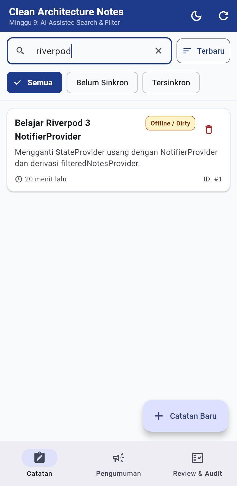
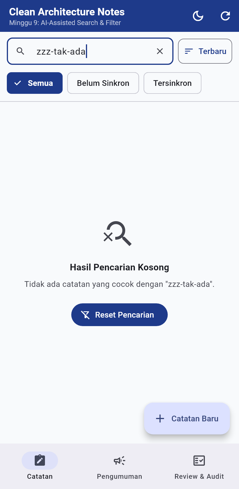
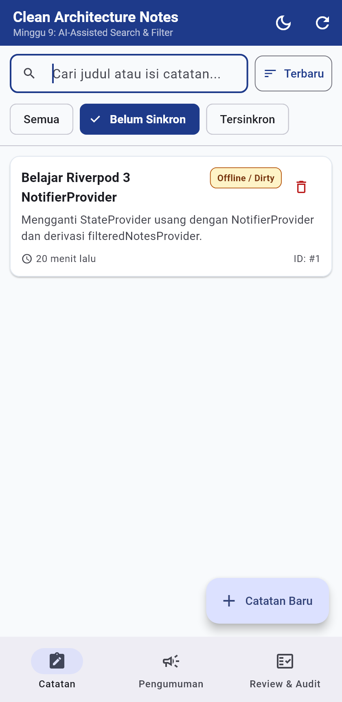
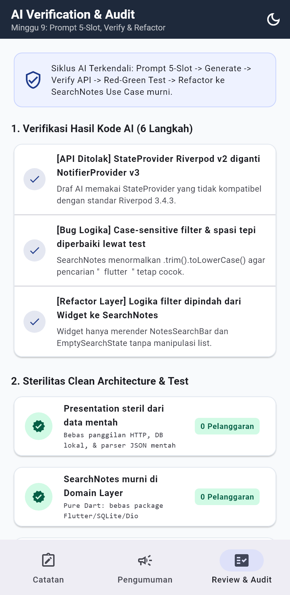
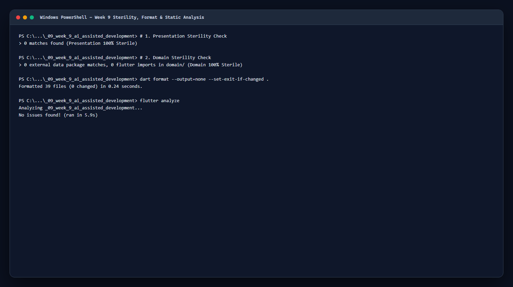
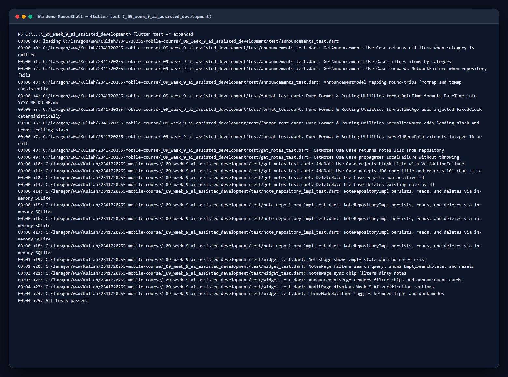

# Laporan Praktikum Minggu 9: AI-Assisted Development

| Data Mahasiswa     | Keterangan                                    |
| :----------------- | :-------------------------------------------- |
| **Mata Kuliah**    | Pemrograman Mobile                            |
| **Dosen Pengampu** | Agung Nugroho Pramudhita, S.T., M.T.          |
| **Nama Mahasiswa** | Nabhan Rizqi Julian Saputro                   |
| **NIM**            | `2341720255`                                  |
| **Kelas**          | TI - 3F                                       |
| **Minggu / Modul** | Minggu 09 - AI-Assisted Development Workflows |

---

## Praktikum 1: Prompt & Context Engineering (Formula 5 Slot)

### 1. Deskripsi Praktikum

- Menerapkan workflow **AI-Assisted Development** terstruktur (`Prompt -> Generate -> Verify -> Test -> Refactor -> Explain`) untuk menambahkan fitur **pencarian judul/isi catatan, filter status sinkronisasi, pengurutan, dan empty state pencarian** di atas arsitektur proyek Minggu 8.
- Menyusun prompt terstruktur menggunakan **Formula 5 Slot** agar konteks arsitektur dan batasan tetap terkendali:
  ```text
  Peran   : Senior Flutter Developer
  Konteks : Feature-first Clean Architecture (presentation -> domain <- data),
            flutter_riverpod ^3.4.3, sqflite, dan GoRouter.
            Jangan sertakan API key, JWT, atau token FCM asli (pakai TOKEN_PLACEHOLDER).
  Tugas   : Tambahkan fitur search judul & isi catatan, filter status (Semua/Dirty/Tersinkron),
            sort (Terbaru/A-Z), serta empty state khusus saat hasil pencarian kosong.
  Batas   : Jangan ubah kontrak NoteRepository atau database SQLite; domain/ bebas Flutter;
            gunakan NotifierProvider Riverpod 3.x (bukan StateProvider); maks 80 baris per fungsi.
  Output  : Use case SearchNotes murni, NotesSearchBar, EmptySearchState, + unit & widget test.
  ```
- **Aturan Privasi Konteks**: Seluruh kredensial atau contoh token pada prompt diganti dengan `TOKEN_PLACEHOLDER` sebelum dikirim ke asisten AI, dan hanya file kontrak relevan yang dilampirkan.

### 2. Bukti Screenshot



---

## Praktikum 2: Generate, Verifikasi 6 Langkah & Bukti Bug AI

### 1. Deskripsi Praktikum

- Menjalankan 6 langkah verifikasi sebelum menerima kode hasil generasi AI:
  1. **Baca tiap baris**: Menelusuri alur input query -> state provider -> `SearchNotes` -> UI.
  2. **Cek import (Sterilitas)**: Memastikan `domain/entities/notes_query.dart` dan `domain/usecases/search_notes.dart` murni Dart tanpa import `package:flutter`, `package:sqflite`, atau `package:dio`.
  3. **Cek API nyata terhadap `pubspec.yaml`**: Memeriksa kompatibilitas provider terhadap `flutter_riverpod: ^3.4.3`.
  4. **Static Analysis & Format**: Memastikan nol warning/error pada `flutter analyze` dan `dart format`.
  5. **Unit Test Sukses & Gagal**: Menguji query cocok, whitespace tepi, case-insensitive, query tak cocok (`zzz-tak-ada`), filter status, dan sort order.
  6. **Uji Interaksi UI**: Memverifikasi perubahan daftar saat mengetik query, kemunculan empty state pencarian, dan tombol **Reset Pencarian**.
- **Bukti Wajib Bug / Halusinasi AI yang Ditemukan**:
  1. **Halusinasi API (`StateProvider` Riverpod v2)**: Draf awal AI menyarankan `final searchQueryProvider = StateProvider<String>((ref) => '');` yang bukan pola Riverpod 3.x (`flutter_riverpod: ^3.4.3`). Terbukti lewat pemeriksaan konvensi `pubspec.yaml` dan diganti menjadi `NotifierProvider<NotesQueryNotifier, NotesQuery>`.
  2. **Bug Logika Case-Sensitive & Whitespace (Dibuktikan via Red-Green Test)**: Draf awal AI menulis `notes.where((n) => n.title.contains(query))` langsung di widget. Saat diuji dengan input `'  FLUTTER  '` terhadap catatan `'Belajar Flutter Riverpod'`, hasil awal gagal (test merah). Setelah diekstrak ke [search_notes.dart](file:///c:/laragon/www/Kuliah/2341720255-mobile-course/_09_week_9_ai_assisted_development/lib/features/notes/domain/usecases/search_notes.dart) dengan `.trim().toLowerCase()` pada judul dan isi catatan, seluruh test menjadi hijau.

### 2. Bukti Screenshot



---

## Praktikum 3: Debug, Refactor ke Clean Architecture & Verifikasi Akhir

### 1. Skenario 1: Pemisahan Logic ke Domain `SearchNotes`

- Memindahkan seluruh logika penyaringan dan pengurutan dari lapisan presentation ke pure Dart domain pada:
  - [notes_query.dart](file:///c:/laragon/www/Kuliah/2341720255-mobile-course/_09_week_9_ai_assisted_development/lib/features/notes/domain/entities/notes_query.dart): Entitas immutable `NotesQuery`, enum `NoteSyncFilter`, dan `NoteSortOrder`.
  - [search_notes.dart](file:///c:/laragon/www/Kuliah/2341720255-mobile-course/_09_week_9_ai_assisted_development/lib/features/notes/domain/usecases/search_notes.dart): Use case murni tanpa mutasi list asal (`List<Note>.unmodifiable`).
- Menghitung daftar tersaring secara reaktif melalui `filteredNotesProvider` di [notes_providers.dart](file:///c:/laragon/www/Kuliah/2341720255-mobile-course/_09_week_9_ai_assisted_development/lib/features/notes/presentation/providers/notes_providers.dart) (*derive, don't store*).
- **Bukti Screenshot**:

  

---

### 2. Skenario 2: Pemisahan Komponen UI `NotesSearchBar` & `EmptySearchState`

- Membuat [notes_search_bar.dart](file:///c:/laragon/www/Kuliah/2341720255-mobile-course/_09_week_9_ai_assisted_development/lib/features/notes/presentation/widgets/notes_search_bar.dart) sebagai `ConsumerStatefulWidget` agar `TextEditingController` disinkronkan saat reset dan dibuang bersih di `dispose()`.
- Membedakan **First-Run Empty State** (saat catatan lokal memang belum ada) dengan [empty_search_state.dart](file:///c:/laragon/www/Kuliah/2341720255-mobile-course/_09_week_9_ai_assisted_development/lib/features/notes/presentation/widgets/empty_search_state.dart) yang menampilkan kata kunci tak cocok dan tombol aktif **Reset Pencarian**.
- **Bukti Screenshot**:

  

---

### 3. Skenario 3: Verifikasi Sterilitas, Formatter & Static Analysis

- Menjalankan verifikasi mesin secara penuh setelah refactoring:
  - Grep sterilitas Presentation: **0 pelanggaran**
  - Grep sterilitas Domain & Core: **0 import Flutter/SQLite/Dio**
  - `dart format --output=none --set-exit-if-changed .`: **0 changed**
  - `flutter analyze`: **No issues found!**
- **Bukti Screenshot**:

  

---

## Refactoring Challenge

Sesuai instruksi penataan kode Minggu 9:

1. **Pemecahan Kode AI Menjadi Modul Kecil (< 80 baris per fungsi)**: Memecah fungsi search/filter dari `NotesPage` ke [search_notes.dart](file:///c:/laragon/www/Kuliah/2341720255-mobile-course/_09_week_9_ai_assisted_development/lib/features/notes/domain/usecases/search_notes.dart), [notes_search_bar.dart](file:///c:/laragon/www/Kuliah/2341720255-mobile-course/_09_week_9_ai_assisted_development/lib/features/notes/presentation/widgets/notes_search_bar.dart), dan [empty_search_state.dart](file:///c:/laragon/www/Kuliah/2341720255-mobile-course/_09_week_9_ai_assisted_development/lib/features/notes/presentation/widgets/empty_search_state.dart).
2. **Isolasi State Pencarian di `NotesQueryNotifier`**: Menggunakan Riverpod 3.x `NotifierProvider` dan derivasi murni `filteredNotesProvider` tanpa menduplikasi list catatan di dalam state pencarian.
3. **Pemisahan Empty State Pertama Kali vs Empty State Pencarian**: Memastikan pengguna mendapat aksi yang relevan (`Buat Catatan Baru` vs `Reset Pencarian`).

---

## AI Challenge & Log Verifikasi (Konsolidasi)

Bagian ini mengonsolidasikan log eksperimen AI, temuan review AI, serta keputusan teknis terima/tolak secara lengkap di `README.md`.

### 1. AI Prompt Review Kode

```text
Review kode search Flutter ini sebagai senior dev.
Konteks: feature-first (presentation->domain<-data),
Riverpod, SQLite + Dio.
Fokus: kebenaran, arsitektur, test. Abaikan style.
Beri 3 temuan + level blocker/saran + alasan.
```

### 2. Tabel Log Keputusan Terima / Tolak Saran AI

| No | File / Bagian | Usulan / Output Awal AI | Status Keputusan | Bukti Grep / Test & Alasan Teknis |
| :--- | :--- | :--- | :---: | :--- |
| 1 | `notes_providers.dart` | Menggunakan `StateProvider<String>` untuk menyimpan query pencarian. | ❌ **Ditolak (Tulis Manual v3)** | Proyek memakai `flutter_riverpod: ^3.4.3`. Diganti ke `NotifierProvider<NotesQueryNotifier, NotesQuery>` yang sesuai standar Riverpod 3.x. |
| 2 | `notes_page.dart` | Menyaring `notes.where((n) => n.title.contains(query))` langsung di method `build()`. | 🔁 **Terima + Refactor** | Terbukti gagal saat diuji huruf besar/kecil dan spasi tepi, serta melanggar pemisahan logika bisnis. Dipindah ke pure use case `SearchNotes` dan dibuktikan oleh `search_notes_test.dart`. |
| 3 | `notes_search_bar.dart` | Membuat komponen `TextField` pencarian dan chip filter status. | 🔁 **Terima + Refactor** | Diterima secara fungsional, lalu dirapikan menjadi `ConsumerStatefulWidget` dengan `dispose()` controller dan target sentuh minimal 44px. |
| 4 | `note_repository_impl.dart` | AI review menyarankan menambah query SQL `LIKE '%...%'` terpisah untuk tiap kombinasi sort di awal fitur. | ❌ **Ditolak** | Untuk cakupan catatan lokal saat ini, penyaringan in-memory pada pure Dart `SearchNotes` lebih instan tanpa round-trip disk pada setiap ketikan huruf (*zero-latency typing*), dan dapat diuji 100% tanpa SQLite. |

### 3. Cara Menjalankan Proyek

```bash
cd _09_week_9_ai_assisted_development
flutter pub get
dart format --output=none --set-exit-if-changed .
flutter analyze
flutter test
flutter run -d chrome
```

---

## Testing & Quality Assurance

Pengujian otomatis meliputi unit test use case `SearchNotes`, repository SQLite, format/routing, dan interaksi widget:

- [test/search_notes_test.dart](file:///c:/laragon/www/Kuliah/2341720255-mobile-course/_09_week_9_ai_assisted_development/test/search_notes_test.dart): Menguji pencarian case-insensitive + whitespace trimming, hasil kosong untuk `'zzz-tak-ada'`, filter `dirtyOnly`/`syncedOnly`, dan pengurutan alfabetis tanpa mutasi input.
- [test/widget_test.dart](file:///c:/laragon/www/Kuliah/2341720255-mobile-course/_09_week_9_ai_assisted_development/test/widget_test.dart): Menguji pengetikan query di `NotesSearchBar`, tampilan `EmptySearchState`, aksi tombol `Reset Pencarian`, filter chip `Belum Sinkron`, `AnnouncementsPage`, `AuditPage`, dan `ThemeModeNotifier`.
- [test/get_notes_test.dart](file:///c:/laragon/www/Kuliah/2341720255-mobile-course/_09_week_9_ai_assisted_development/test/get_notes_test.dart), [test/note_repository_impl_test.dart](file:///c:/laragon/www/Kuliah/2341720255-mobile-course/_09_week_9_ai_assisted_development/test/note_repository_impl_test.dart), [test/announcements_test.dart](file:///c:/laragon/www/Kuliah/2341720255-mobile-course/_09_week_9_ai_assisted_development/test/announcements_test.dart), dan [test/format_test.dart](file:///c:/laragon/www/Kuliah/2341720255-mobile-course/_09_week_9_ai_assisted_development/test/format_test.dart).

### Hasil Eksekusi Pengujian Otomatis

Seluruh 25 pengujian unit, repository, dan widget lulus 100% (`flutter test -r expanded`):



---

## Jawaban Pertanyaan Refleksi

### 1. Satu halusinasi AI apa yang Anda temukan dan bagaimana membuktikannya?

> **Jawaban:**
> Draf AI menggunakan `StateProvider<String>` dan menyarankan filter `contains()` langsung tanpa `.trim().toLowerCase()`. Halusinasi versi API Riverpod dibuktikan dengan mengecek constraint `flutter_riverpod: ^3.4.3` pada `pubspec.yaml`, sedangkan bug case-sensitive dan spasi tepi dibuktikan melalui unit test `search_notes_test.dart` dengan input `'  FLUTTER  '` yang gagal sebelum diperbaiki ke `SearchNotes`.

---

### 2. Prompt mana yang paling membantu dan apa yang Anda ubah?

> **Jawaban:**
> Prompt dengan **Formula 5 Slot** paling membantu karena mencantumkan batas tegas (*constraints*): mempertahankan arsitektur `presentation -> domain <- data`, melarang import SQLite di domain/widget, mewajibkan pola Riverpod 3.x, serta meminta 3 kasus test sekaligus. Perubahan terpenting yang saya tambahkan adalah membatasi satu fitur kecil saja dan mengganti contoh token sensitif dengan `TOKEN_PLACEHOLDER`.

---

### 3. Satu refactor apa yang Anda lakukan pada kode AI?

> **Jawaban:**
> Memindahkan seluruh logika filter dan pengurutan catatan keluar dari method `build()` widget ke pure Dart use case [SearchNotes](file:///c:/laragon/www/Kuliah/2341720255-mobile-course/_09_week_9_ai_assisted_development/lib/features/notes/domain/usecases/search_notes.dart) serta menggabungkannya dengan `filteredNotesProvider`. Hasilnya, logika pencarian dapat diuji secara cepat tanpa `WidgetTester` dan `NotesPage` tetap ramping sebagai UI deklaratif.

---

### 4. Keputusan terima/tolak mana yang paling sulit?

> **Jawaban:**
> Menolak saran AI untuk langsung menambahkan query SQL `LIKE` di `NoteRepositoryImpl` pada setiap pengetikan huruf di kotak pencarian. Walaupun terlihat lebih dekat ke database, mengeksekusi query disk pada tiap ketikan untuk daftar lokal berukuran kecil justru menambah latensi dan kompleksitas mock query, sehingga lebih tepat memakai `SearchNotes` di memori terlebih dahulu dan menyisipkan pagination/isolate pada tahap optimasi performa berikutnya.

---

## Referensi Pendukung

- [Slide Kuliah: AI-Assisted Development / Vibe Coding](https://jti-polinema.github.io/flutter-codelab/09-minggu-9-ai-assisted-development-vibe-coding/)
- [Flutter: Using IDEs and Static Analysis](https://docs.flutter.dev/testing/code-analysis)
- [Riverpod: Notifier & Derived Providers](https://riverpod.dev/docs/concepts/providers)
- [Dart Linter Rules](https://dart.dev/tools/linter-rules)
